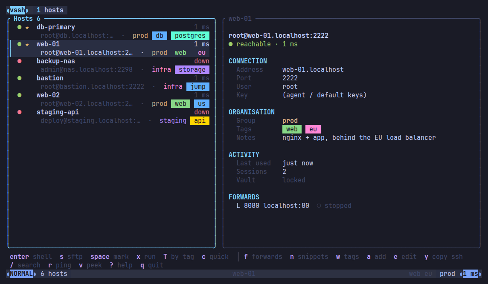
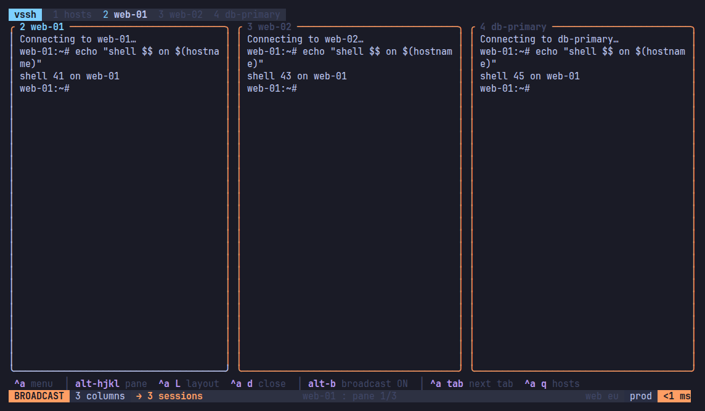
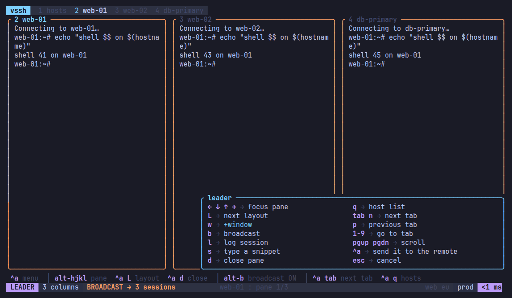

# vssh

[](https://github.com/DucLong06/vssh/actions/workflows/ci.yml)

**English** · [Tiếng Việt](README.vi.md)

A terminal SSH manager: host list on the left, details or a live session on
the right, vim keys everywhere. Hosts live in your normal `~/.ssh/config`, so
plain `ssh` keeps working with everything vssh edits.


- SSH sessions in tabs, with a built-in terminal emulator
- Several hosts side by side in split panes, and broadcast: type once, run everywhere
- Quick connect to `user@host`, with or without saving the host and its password
- Dual-pane SFTP browser with a progress bar
- Local, remote and dynamic (SOCKS5) port forwards per host
- Encrypted password vault, command snippets, groups and tags, fuzzy search
- Session logs, login scripts, English or Vietnamese interface

| Host list and details | Broadcast to three hosts |
|---|---|
|  |  |
| **Leader menu (`Ctrl-a`)** | **SFTP** |
|  |  |

All pictures are captured from the real app by [`docs/img/demo.sh`](docs/img/demo.sh) (terminal contents rendered to images), in this interface language; the hosts in them are a local demo container.

Linux and macOS. Pure Rust SSH ([russh](https://github.com/warp-tech/russh)); no `ssh` binary needed.

## Install

```sh
curl -fsSL https://raw.githubusercontent.com/DucLong06/vssh/main/install.sh | sh
```

Installs to `~/.local/bin` (`--prefix DIR` changes that); run it again to update. It uses a release binary when one exists for your machine and otherwise builds with `cargo`. The installer speaks English or Vietnamese, chosen from your locale; force it with `sh -s -- --lang vi` or `VSSH_LANG=vi`.

## Build

Needs Rust 1.89+ and a C compiler (for the bundled SQLite).

```sh
cargo build --release
./target/release/vssh        # or: sh install.sh, from the checkout
```

## Quickstart: first connection

1. Start `vssh`. Every host in `~/.ssh/config` is listed. No hosts yet? Press `a` to add one (next section).
2. Move with `j` / `k`, press `Enter`. A shell opens in a new tab.
3. Login tries your SSH agent, then key files, then the vault password. If all are refused, vssh asks for a password once.
4. The first time you reach a host its key is saved to `~/.ssh/known_hosts`. If that key ever changes, vssh refuses to connect.
5. `Ctrl-a q` returns to the host list, `Ctrl-a x` closes the session, `q` quits. After `Ctrl-a` a menu shows every key you can press next.

`r` checks which hosts answer: a green dot with the connect time, a red dot for hosts that are down, a hollow gray dot for hosts not checked yet.

## Quick connect

Press `c`, type `user@host` or `user@host:port`, optionally a password, and press `Enter`. A session opens in a tab. Nothing is saved: no entry in `~/.ssh/config`, no vault entry, no statistics; the password is used for that session only. The host key is still checked and recorded in `~/.ssh/known_hosts`, as with `ssh`.

**Save while connecting.** Tick the checkbox in the form with `Ctrl-s` (or `Tab` to it and press `S`), then `Enter`:

- the host is added to `~/.ssh/config` like any other host. Its alias is the host name, or `user@host` if that name is already taken;
- a password you typed is stored in the vault under that alias, encrypted like every vault password. If the vault is locked you are asked for the master passphrase (or to create a vault); cancel that prompt and the password is dropped, not stored;
- the password is never written to `~/.ssh/config` or `config.toml`.

A plain `S` cannot be the toggle while the cursor is in a text field, because it is a letter you may need to type; that is why the shortcut is `Ctrl-s`.


## Many hosts at once

- **Open several:** mark hosts with `Space`, then `Enter` opens a session on each. Or press `T`, type a tag or group, and every host with it is connected.
- **Any screen shape:** the layout follows the terminal — side by side in wide windows, stacked full-width in tall ones (phones on Termux, vertical monitors), one panel at a time when there is no room. Override with `layout = "landscape"|"portrait"` in the config.
- **Layouts:** the sessions appear side by side. `Ctrl-a L` cycles single, 2 columns, 2x2 grid, 3 columns; `Ctrl-a w` then `s` `v` `g` `t` picks one directly. With more sessions than panes, the view follows the focused one.
- **Focus:** `Alt-h/j/k/l` moves between panes like vim windows (also `Ctrl-a` + arrow). `Ctrl-a d` closes the focused session.
- **Broadcast:** `Alt-b` (or `Ctrl-a b`). While it is on, what you type or paste goes to *every* connected session, including ones not on screen. The status line turns orange and shows how many sessions are listening, and their panes get an orange border. Press `Alt-b` again to stop.
- **Snippets:** `Ctrl-a s` types a saved snippet into the session, or into all of them while broadcasting.
- **One command, many hosts:** mark hosts with `Space`, press `x`, type a command. It runs on every marked host at once, each over its own connection, with no session opened. The results fill in as hosts answer, one `host │ output` line per line, the host in the colour of its tag; a host still running shows a spinner, a host that failed shows why. `j`/`k` scroll, `/` shows only hosts whose name contains what you type, `Esc` closes and drops the hosts that have not answered. Broadcast is for typing into live sessions; `x` is for a one-off. A snippet run on marked hosts uses the same view.

## Status bar

The bottom line shows the mode, the focused host and pane, then its tags, group and latency. In a wide window it also shows how the server is doing:

```
 TERMINAL  single          web-01 : pane 1/1          CPU ▂ 23% · MEM ▂ 4.2/16G · / ▅ 61%   web  prod  12 ms
```

- **CPU** is the 1-minute load average per core (over 100% means work is queueing), **MEM** is used / total memory, **/** is how full the root file system is. Each turns yellow, then red: CPU above 50% / 80%, memory above 70% / 85%, disk above 80% / 90%.
- **In a session** the numbers are read every 5 seconds over a second channel of the connection that is already open: no extra login. Linux servers (`/proc`) and macOS servers (`uptime`, `vm_stat`) are understood; a host that does not answer shows nothing.
- **On the host list**, resting on a host for a moment asks it once. Only a host you have connected to before (its key is in `known_hosts`) is asked, and only with your agent or key files: a vault password is never sent for this. A host with a session open uses that session's numbers; a host that refuses is not asked again.
- **Little room:** the bars go first, then disk, then memory. Portrait and small windows keep to mode and host.
- `status_stats = false` in the config turns all of it off.
- **Rounded badges:** the mode, the latency and the `vssh` mark are pills with half-circle ends (`◖NORMAL◗`). With a Nerd Font, `nerd_font = true` uses its full-height Powerline caps instead; without such a font those would show as empty boxes, so it is off by default.
- **Tab switches:** the tab you switch to slides in from the right over three frames (120 ms). Remote terminals are not resized while it moves. On a slow link three redraws are three round trips: `transitions = false` turns it off.

## Copy to the clipboard

vssh has no clipboard library. It asks the terminal it runs in to do the copy, with the OSC 52 escape, so it also works over SSH to the machine vssh runs on.

- **Host list:** `y` copies `ssh <host>`.
- **Session:** `Ctrl-a y` copies the output of the last command: the lines between the prompt you are at and the prompt before it. If the prompt is not the same text both times (a clock in it, or something already typed), everything above the cursor is copied instead. Only what is on screen counts. It is `Ctrl-a y` and not a bare `y`, because a bare `y` belongs to the shell.
- **SFTP:** `y` copies the full path of the selected file.
- **Terminal support:** most current terminals accept OSC 52 (some ask first or need it enabled). Inside tmux, vssh also hands the text to tmux itself (`tmux load-buffer -w`), since tmux ignores OSC 52 from programs unless `set-clipboard on`. `osc52 = false` stops the escape for a terminal that prints it instead of obeying it; the tmux buffer is still set.

## Quick peek

`v` on the host list opens a small window with what the host says about itself: name, system (`uname -srm`), uptime, the three load averages, CPU, memory and root disk. No shell is opened: it is one command over a short connection, with the same host key check and login as a session (agent, keys, then the vault password).

- The answer is kept for 30 seconds, so opening the window again is instant; `r` or `Enter` asks again, `Esc` or `q` closes.
- What the host did not answer is a dash; the rest is still shown. If the connection fails, the window says why, in the wording of the next section.

## When a connection fails

vssh says why, not only that it failed. A popup shows the reason and the full error chain; the host's details keep the last failure, in red, until a connection to it succeeds.

| Shown | What happened |
|-------|---------------|
| `DNS` Cannot resolve db.internal: … | the name lookup failed; the resolver's own words follow |
| `TIMEOUT` Connection timed out after 10s (203.0.113.7:22) | nothing answered at that address |
| `REFUSED` Connection refused by 203.0.113.7:22 — is sshd running? | the machine answered, nothing listens on the port |
| `UNREACHABLE` Cannot reach 203.0.113.7:22: … | no route; the system's own words follow |
| `AUTH` Wrong password / Public key rejected / No way to log in | which method the server refused; you are then asked for a password |
| `HOST KEY` Host key mismatch … | the fingerprint the server sent, and the line of `known_hosts` it conflicts with |
| `ERROR` … | anything else, shown word for word |

Snippets run on several hosts and port forwards report failures with the same wording.

## Session logs and login scripts

- **Log a session:** `Ctrl-a l` starts and stops a log in `~/.local/share/vssh/logs/<host>-<date>-<time>.log` (mode 0600). It holds everything the terminal shows, raw and unmasked, so passwords that are printed end up in it; read it with `less -R`. `log_sessions = true` in the config logs every session.
- **Login script:** list a command under `[exec]` in `config.toml` and it is typed into the shell right after login. `RemoteCommand` in `~/.ssh/config` is honoured too: it runs *instead of* the shell, as with `ssh`.

## Adding a server

**From the TUI.** Press `a`, fill in the form (`Tab` moves between fields), press `Enter`:

| Field | Meaning |
|-------|---------|
| Alias | short name shown in the list |
| HostName | address or DNS name |
| User, Port, IdentityFile | optional; default to your user, 22, and your agent / default keys |
| Group, Tags, Notes | optional; kept by vssh only |

The host is written to `~/.ssh/config` as a normal `Host` block. `e` edits, `y` duplicates, `d` deletes.

**From `~/.ssh/config`.** Add a block and restart vssh (the file is read at startup):

```
Host web1
    HostName 203.0.113.10
    User deploy
    Port 2222
    IdentityFile ~/.ssh/id_ed25519
```

Comments, unknown options and `Host *` defaults are preserved. Before its first change vssh saves a copy as `~/.ssh/config.vssh.bak`.

## Groups and tags

Press `e` on a host and fill in **Group** (one name, e.g. `prod`) and **Tags** (separated by spaces or commas, e.g. `web eu`). Hosts are sorted pinned first, then by group; groups and tags are coloured.

| Type | Shows |
|------|-------|
| `/#web` | hosts with a tag or group starting with `web` |
| `/#` | every host that has a tag or group |
| `/web` | fuzzy match on alias, hostname, user, group and tags |

`Enter` keeps the filter, `Esc` clears it. Groups and tags are stored in vssh's own database, not in the ssh config.

**Tag drawer.** `w` opens a drawer on the right with every tag and group as a coloured pill and the number of hosts it lists, most used first. `1`-`9` filter the host list by that tag (the same as typing `/#tag`, so the number is exactly how many hosts you get); `j`/`k` and `Enter` pick one further down. `0` clears the filter, `/` narrows the drawer itself by typing, `w` or `q` closes it and keeps the filter, `Esc` closes it and clears the filter.

## Keys

`?` shows this list inside vssh.

| Where | Key | Action |
|-------|-----|--------|
| Host list | `j` `k` `g` `G` | move, first, last |
| | `Ctrl-d` / `Ctrl-u` | half a screen down / up |
| | `Enter` / `s` | open shell / SFTP browser |
| | `Space`, then `Enter` | mark hosts, then open a session on every marked host |
| | `T` | connect to every host with a tag or group |
| | `x` | run one command on every marked host (the selected one if none is marked) |
| | `c` | quick connect; `Ctrl-s` in the form saves the host and its password |
| | `/` | search (`#tag` for a tag or group); `Esc` clears |
| | `a` `e` `d` `Y` | add, edit, delete, duplicate host |
| | `y` | copy `ssh <host>` to the clipboard |
| | `p` | pin host |
| | `f` / `n` | port forwards / snippets of the host |
| | `w` | tag drawer: `1`-`9` filter by a tag, `0` or `Esc` clear, `/` search the tags |
| | `r` | check which hosts are reachable |
| | `v` | quick peek: uptime, load, memory and disk of the host, without a session |
| | `P` / `V` | store a password in the vault / unlock or lock the vault |
| | `Tab` / `Shift-Tab` | next / previous tab |
| | `?` | help |
| | `q`, `Q` or `Ctrl-c` | quit |
| Forwards, snippets | `a` `e` `d` | add, edit (snippets), delete |
| | `Enter` | start/stop the forward, run the snippet |
| | `Esc` | back |
| Sessions | `Alt-b` or `Ctrl-a` `b` | broadcast typing to all sessions, on / off |
| | `Alt-h` `j` `k` `l` | focus the pane left / below / above / right |
| | `Ctrl-a` `L` | next layout: single, 2 columns, 2x2, 3 columns |
| | `Ctrl-a` `w` | window menu: `h` `j` `k` `l` focus, `s` `v` `g` `t` layout, `d` close |
| | `Ctrl-a` `l` | log the session to a file, on / off |
| | `Ctrl-a` `s` | type a snippet into the session |
| | `Ctrl-a` `y` | copy the last command's output to the clipboard |
| | `Ctrl-a` `d` or `x` | close the session |
| | `Ctrl-a` `q` | back to the host list |
| | `Ctrl-a` `Tab` / `p`, `1`-`9` | next / previous tab, go to tab |
| | `Ctrl-a` `PgUp` / `PgDn` | scroll back / forward (also `Ctrl-u` / `Ctrl-d`) |
| | `Ctrl-a` `Ctrl-a` | send `Ctrl-a` to the remote |
| SFTP | `Tab` | switch pane (left local, right remote) |
| | `Enter` / `h` | open directory / parent |
| | `c` | copy file to the other pane |
| | `m` `r` `d` `R` | mkdir, rename, delete, refresh |
| | `y` | copy the path of the selected file to the clipboard |
| | `q` / `Q` | close / quit |

`Alt-b` and, while several panes are shown, `Alt-h/j/k/l` are taken by vssh and no longer reach the remote shell. Coming from an older version: `Ctrl-a h` (host list) is now `Ctrl-a q`, `Ctrl-a k` / `j` (scroll) are now `Ctrl-a PgUp` / `PgDn`, and duplicate moved from `y` to `Y` when `y` became copy (a config that sets `duplicate = "y"` keeps it).

A forward is typed like the `ssh` flags: `L 8080 localhost:80`, `R 9000 localhost:3000`, `D 1080`.

## Security

- **Host keys:** unknown hosts are recorded on first contact; a known host must present a recorded key, otherwise the connection is refused.
- **Vault:** `P` stores a host's password in `~/.local/share/vssh/vault` (mode 0600), encrypted with Argon2id + XChaCha20-Poly1305. There is no recovery if you lose the master passphrase.
- **Known advisory:** `cargo audit` reports [RUSTSEC-2023-0071](https://rustsec.org/advisories/RUSTSEC-2023-0071) (timing side channel in the `rsa` crate, pinned by russh). It affects signing with an RSA key *file*. Prefer Ed25519 keys, or keep RSA keys in `ssh-agent`. Details: `.cargo/audit.toml`.

## Files and configuration

| Path | Contents |
|------|----------|
| `~/.ssh/config`, `~/.ssh/known_hosts` | hosts, forwards, host keys (shared with OpenSSH) |
| `~/.local/share/vssh/vssh.db` | groups, tags, notes, pins, stats, snippets |
| `~/.local/share/vssh/vault` | encrypted passwords |
| `~/.local/share/vssh/logs/` | session logs, when you turn them on |
| `~/.config/vssh/config.toml` | optional settings, theme and keys |

```toml
lang = "en"             # "vi" for Vietnamese key hints, menus and help
ping_on_start = false   # check every host at launch
log_sessions = false    # log every session from the start
status_stats = true     # load, memory and disk of the focused host in the status bar
nerd_font = false       # true: Powerline round caps on the badges (needs a Nerd Font)
transitions = true      # slide a tab in over three frames when switching to it
osc52 = true            # copy through the OSC 52 terminal escape

[exec]                  # login scripts: typed into the shell after login
web-01 = "cd /srv/app && git status"

[theme]                 # colour names or "#rrggbb"
accent = "cyan"         # also: border, text, dim, selection, ok, error, warn, bar, key

[keys]                  # one character each; leader is pressed with Ctrl
leader = "a"            # also: quit, search, sftp, connect, connect_tag, forwards, snippets, tags,
quit = "q"              # add, edit, delete, duplicate, copy, pin, mark, ping, batch, peek, password, vault, help
```

Entries you leave out keep their defaults, so a config written for an older version still works. The language can also be set per run with `vssh --lang vi` or `VSSH_LANG=vi`; forms and error messages stay in English.

## Not supported

`ProxyJump` / `ProxyCommand`, `Include`, passphrase-protected key files (use the agent), keyboard-interactive / 2FA, copying directories over SFTP, Telnet, serial, Zmodem, X11 forwarding, mouse. The reasons are in [docs/PLAN.md](docs/PLAN.md#not-planned).

## Development

```sh
cargo fmt --check && cargo test && cargo clippy --all-targets -- -D warnings
cargo audit    # needs: cargo install cargo-audit
```

Design notes: [docs/PLAN.md](docs/PLAN.md).

## License

MIT. See [LICENSE](LICENSE).
