# vssh


[](https://github.com/DucLong06/vssh/actions/workflows/ci.yml)

**English** · [Tiếng Việt](README.vi.md) · Terminal app: [README-terminal.md](README-terminal.md) · [README-terminal.vi.md](README-terminal.vi.md)

An SSH manager for the way you actually work: pick a host, connect, keep
several sessions, copy files, juggle port forwards — without leaving your
`~/.ssh/config` behind.

One Rust core, two frontends. The **desktop app** is the main one, and this
page is about it. The **terminal app** is the second option: the same core
with vim keys, described in [README-terminal.md](README-terminal.md)
([Tiếng Việt](README-terminal.vi.md)). Both read the same `~/.ssh/config`, the
same database and the same vault, and share the TokyoNight theme.

Pure Rust SSH ([russh](https://github.com/warp-tech/russh)); no `ssh` binary needed. The desktop app runs on Linux x86_64, the terminal app on Linux and macOS.

## Desktop app

Your hosts in a window: a dashboard of host cards with live stats, terminal tabs with broadcast, a dual-pane SFTP view, snippets, batch runs, port forwards and the vault.

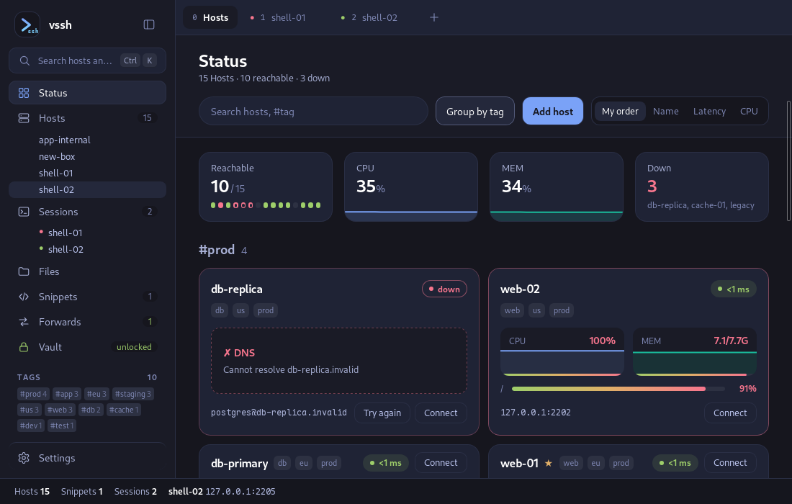

| Quick peek | Terminal tabs, broadcasting |
|---|---|
| 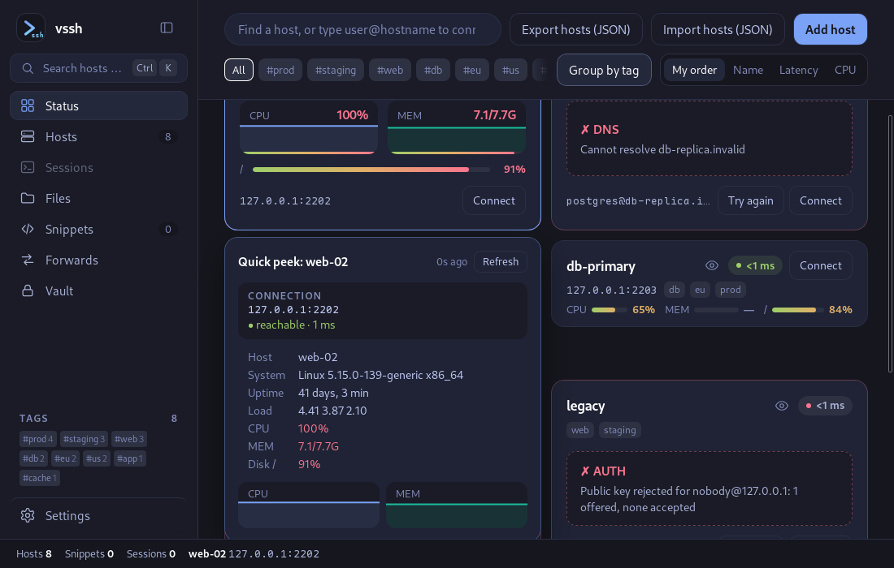 | 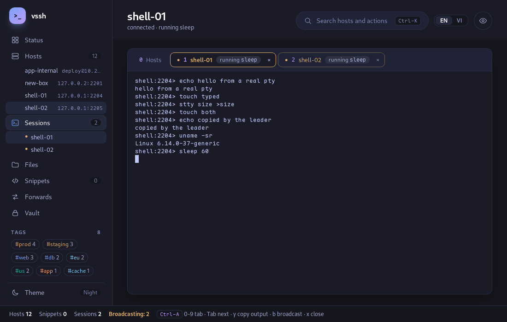 |
| **Two panes, one keyboard** | **Every key** |
| 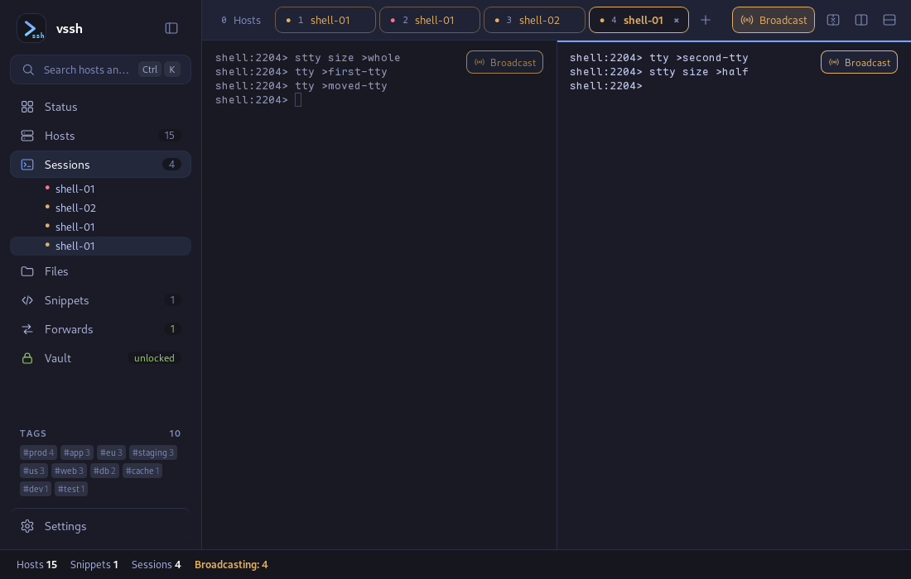 | 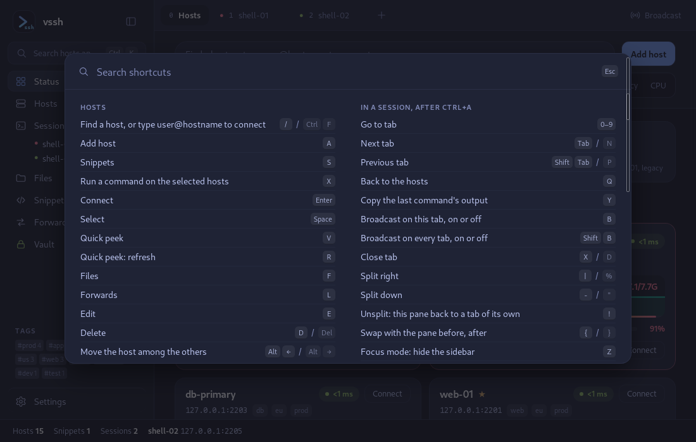 |
| **Files: this machine and the host** | **One command on four hosts** |
| 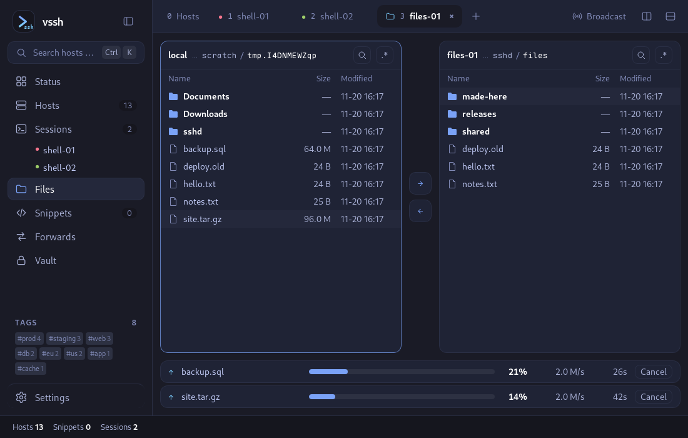 | 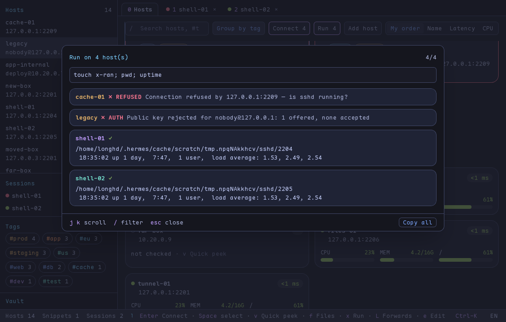 |
| **The host form** | **The vault** |
| 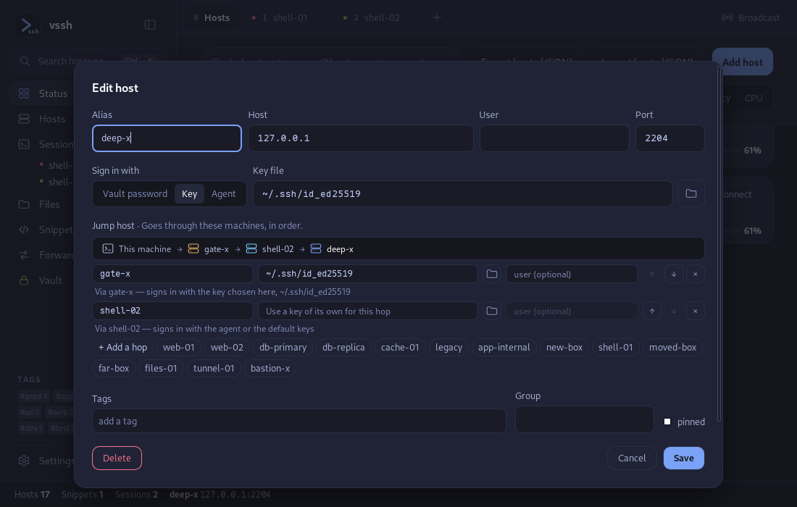 | 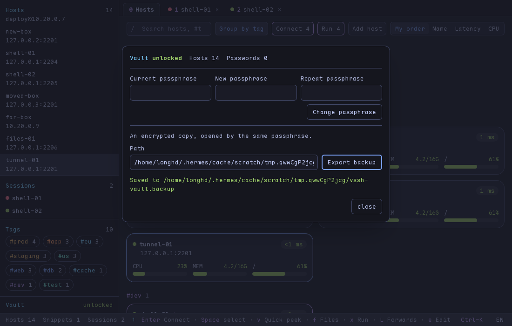 |
| **Day theme** | **Streamer mode** |
| 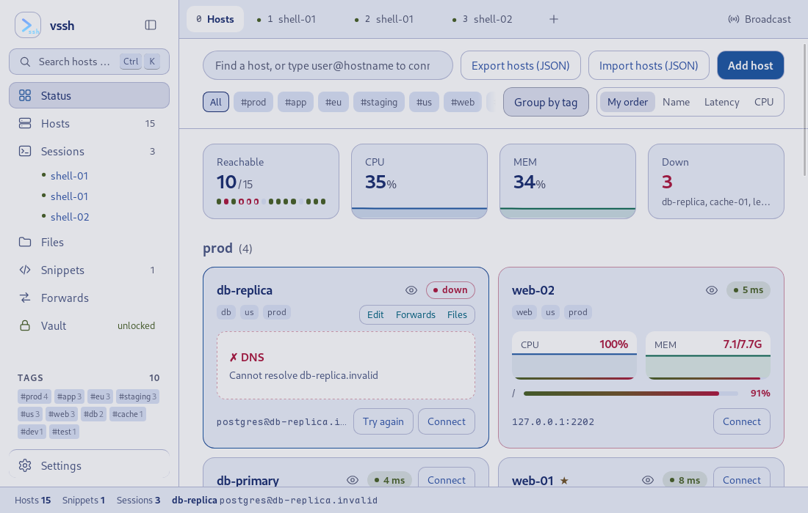 | 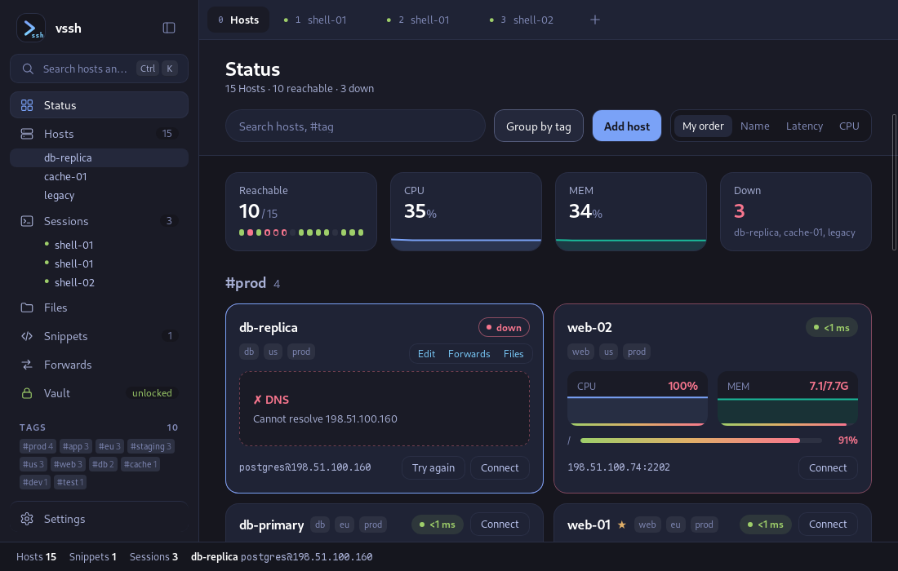 |

All pictures are taken from the real app by [`scripts/gui-smoke.sh`](scripts/gui-smoke.sh), in this interface language; the hosts in them are a throwaway `sshd` on the local machine.

## Features

- **Dashboard.** Every host of `~/.ssh/config` is a card in the middle of the window: its name, `user@host`, its tags, a latency badge, sparklines of CPU and memory over the last minute, a bar for the root disk. The rail on the left lists no hosts: it leads to the views and counts. Above the cards a row of figures: hosts reachable, CPU, memory, and which hosts are down. A host that is down or past a critical mark comes first, and its card says why (`DNS`, `REFUSED`, `AUTH`, …) with a "Try again" button.
- **Group, sort, search.** Cards are in sections by group, each headed `name (how many)`, or shown flat; sorted by your own order, name, latency or CPU. Drag a card onto another to reorder, or `Alt` + arrow. `/` searches by name, address or `#tag`, and `Enter` or the arrow down goes to the first card found. Under the search the tags are one row: a click filters, and so does a tag in the rail.
- **The mouse, all of it.** Drag a tab onto a pane's edge to split, drag the divider to resize, drag tabs to reorder them, a middle click closes one. The rail folds to icons only (its header's button), and every view, card, tab, file row and terminal has its right-click menu.
- **The window remembers.** Split panes, tab names, the folded rail, focus mode and the last view come back as they were when the app is opened again.
- **Live stats without surprises.** Stats are read every 5 seconds over one connection per host that is kept open, not a login per round. Only a host you have connected to before (its key is in `known_hosts`) and that needs no jump host is asked; the others say "not checked" until you ask them with `v`. Reachability is checked once a minute.
- **Quick peek.** `v` on a card: what the host says about itself — name, system, uptime, load, CPU, memory, disk — with its address and whether it answers. The answer is kept for 30 seconds; `r` asks again, `Esc` closes.
- **Terminal tabs.** `Enter` or "Connect" opens a real shell in a tab (a PTY over russh, drawn by xterm.js). Mark several cards with `Space` and `Enter` connects to all of them. A tab shows its state and, on Linux hosts, the command running in it. Selecting text copies it; `Ctrl-Shift-V` or the right button pastes. Side by side in panes, a click gives a pane the keys, and the others keep a dim cursor that breathes. When a shell ends the tab offers "Reconnect".
- **Broadcast.** With two shells open, in tabs or panes, the strip of tabs has a "Broadcast" button (`Ctrl-A` `B`): on, what you type or paste in one goes to all of them. The button is lit, those tabs turn yellow and the status bar says "Broadcasting: N". While it is on every pane has its own switch at its top right (`Ctrl-A` `b`): out of it, and in again.
- **When a connection fails** a dialog says why, in the same classes as the terminal app, down to which hop of a jump chain failed. A host key that changed shows the new fingerprint and the `known_hosts` line it conflicts with, and asks: Accept once, Trust, or Cancel.
- **SFTP, two panes.** `f` on a card, "Files" in its right-click menu, or "Files" in the rail, which asks which host: this machine on the left, the host on the right, in a tab of its own. `Space` marks, `c` copies to the other side; so do the two arrows between the panes and dragging rows across. A file that exists on the other side waits for a yes. Right-click for Upload or Download, New folder, Rename, Delete, Refresh. Each transfer has a line under the panes: bar, per cent, speed, time left, Cancel; three run at once. `.` shows hidden files, `/` filters. Files only: directories are not copied.
- **Snippets.** `s`, or "Snippets" in the rail: saved commands, for one host or for all. A snippet may have parameters (`systemctl restart {{unit}}`); they are asked for when it runs. It runs on the hosts you marked.
- **Batch runs.** Mark hosts with `Space`, press `x`, type one command. It runs on all of them at once, each over its own connection; every host shows its output, or the reason it failed. `j`/`k` scroll, `/` filters by host, "Copy all" takes the lot.
- **Port forwards.** `L` on a card, "Forwards" in its right-click menu, or "Forwards" in the rail, which asks which host: the host's forwards in a table — Local, Remote or SOCKS, the port, where it leads, whether it runs. Switch one on or off, add one, delete one. A port that is taken is said in the form, with another port to try.
- **Hosts.** `a` or "Add host", `e` to edit, `d` to delete (it asks first). The form has alias, host, user, port, how to sign in (vault password, key file or agent), jump host, tags, group, pinned, notes; it can import the hosts of another ssh config, with a preview. Hosts are written to `~/.ssh/config` as normal `Host` blocks.
- **Quick connect.** In the hosts' search or in the palette: `user@host[:port]`, and nothing is saved. With such a session in front the status bar offers "Save this host".
- **Vault.** Passwords of your hosts, encrypted with Argon2id + XChaCha20-Poly1305 under one passphrase. A locked vault asks for it as the app starts and stays unlocked until the app is closed. The dialog also creates a vault, changes the passphrase and exports an encrypted backup. A forgotten passphrase cannot be recovered.
- **Streamer mode.** In the settings (the cog at the foot of the rail): every address the window shows becomes a made-up one from the documentation ranges (`203.0.113.x`, `198.51.100.x`), the same for the same host every time. Only what is shown changes: the config, the database and what is sent to a host keep the real ones. Host aliases and what a shell prints are left as they are.
- **Themes.** TokyoNight Night (the default) and Day, switched in the settings. The terminal itself stays Night in both.
- **English and Vietnamese.** The settings switch the window's language; a connection failure is worded in it too.
- **Command palette.** `Ctrl-K` (`Ctrl-Shift-K` in a terminal, where the plain key is the shell's), or the search at the top of the rail: every host and every action, by fuzzy search. `Ctrl-T` opens it for a new tab.

### Keys

| Where | Key | Action |
|-------|-----|--------|
| Anywhere | `Ctrl-K`; in a terminal `Ctrl-Shift-K` | command palette |
| | `Ctrl-Shift-B` (plain `Ctrl-B` when no terminal is in front) | focus mode: the rail hides, the terminal takes the window; `Esc` brings it back |
| | `Ctrl-T` | new tab, from the palette |
| | `?`; in a terminal `Ctrl-A` `?` | the cheatsheet: every key, searched |
| Dashboard | `/` | search hosts, `#tag` for a tag; `Enter` or `↓` to the first card; `user@host` and `Enter` connects |
| | `a` | add a host |
| | `s` | snippets |
| | `x` | run one command on the marked hosts |
| On a card | `Enter` | connect (to every marked host, if any is marked) |
| | `Space` | mark the host |
| | `v` | quick peek; `r` asks again, `Esc` closes |
| | `f` / `L` | files / forwards of the host |
| | `e` / `d` | edit / delete the host |
| | `Alt` + arrow | move the card |
| Tabs | `Ctrl-A`, then `0`-`9` | go to a tab |
| | `Ctrl-A`, then `Tab` or `n` / `p` | next / previous tab |
| | `Ctrl-A`, then `b` / `B` | broadcast: this tab / all tabs |
| | `Ctrl-Shift-D` / `Ctrl-Shift-E` | split the tab right / down; drag a tab onto a pane edge with the mouse does the same |
| | `Ctrl-A`, then `!` | unsplit: the pane becomes its own tab again |
| | a middle click | close a tab |
| | `Ctrl-Shift-V` | paste into the terminal in front |
| | `Ctrl-A`, then `y` | copy the last command's output |
| | `Ctrl-A`, then `q` | back to the dashboard |
| | `Ctrl-A`, then `x` or `d`; `Ctrl-W`, in a terminal `Ctrl-Shift-W` | close the tab |
| | `Ctrl-A` `Ctrl-A` | send `Ctrl-A` to the host |
| Files | `j` `k` `g` `G` | move, first, last |
| | `Enter` or `l` / `h` | into a directory / up |
| | `Space`, `c` | mark, copy to the other side |
| | `/`, `.` | filter by name, show hidden files |

## Install

Linux x86_64, from v0.2.0 on. A [release](https://github.com/DucLong06/vssh/releases) carries three packages; take one:

| Package | For | Install |
|---|---|---|
| `vssh-desktop_<version>_amd64.deb` | Ubuntu 22.04 or newer, Debian 12 or newer | `sudo apt install ./vssh-desktop_<version>_amd64.deb` |
| `vssh-desktop-<version>-1.x86_64.rpm` | Fedora | `sudo dnf install ./vssh-desktop-<version>-1.x86_64.rpm` |
| `vssh-desktop_<version>_amd64.AppImage` | any other distribution | `chmod +x vssh-desktop_<version>_amd64.AppImage`, then run the file |

Start it from the application menu, or as `vssh-desktop`. The `.deb` and the `.rpm` depend on WebKitGTK 4.1 and GTK 3, which the package manager installs with them. Before a release is published its `.deb` is installed in a bare Ubuntu 22.04 and has to show its window: [`scripts/deb-smoke.sh`](scripts/deb-smoke.sh).

### Build from source

To build the `.deb` yourself you need Rust, Node.js 24 and `libwebkit2gtk-4.1-dev`:

```sh
(cd crates/vssh-desktop && npm ci)
scripts/desktop-deb.sh 0.2.0     # -> target/deb/vssh-desktop_0.2.0_<arch>.deb
sudo apt install ./target/deb/vssh-desktop_0.2.0_*.deb
```

## Shared data and configuration

The desktop app has no store of its own: it is the same data as the terminal app. A host, a tag, a snippet, a forward or a vault password made in one is there in the other.

| Path | Contents |
|------|----------|
| `~/.ssh/config`, `~/.ssh/known_hosts` | hosts, forwards, host keys (shared with OpenSSH) |
| `~/.local/share/vssh/vssh.db` | groups, tags, notes, pins, stats, snippets |
| `~/.local/share/vssh/vault` | encrypted passwords |
| `~/.config/vssh/config.toml` | optional settings |

- **`~/.ssh/config`** stays a file `ssh` itself can use. Before its first change vssh saves a copy as `~/.ssh/config.vssh.bak`. The desktop app reads the hosts again every 5 seconds, so a host added by hand or in the terminal app appears without a restart.
- **`~/.config/vssh/config.toml`** is mostly the terminal app's: its keys, colours and status bar ([all of them](README-terminal.md#files-and-configuration)). The desktop app reads one setting from it, `batch_max_parallel`: how many hosts of a batch run a command at once (8 by default; the rest wait their turn).
- **What you choose in the window** — language, theme, streamer mode, the order of your cards — is kept by the window itself, not in `config.toml`.
- **Security** is the core's, so it is the same in both: an unknown host's key is recorded on first contact, a known host must present the recorded key. More, with the one known advisory, in [README-terminal.md](README-terminal.md#security).

## Troubleshooting

**It does not start: `libwebkit2gtk-4.1.so.0` is missing.** The `.deb` and the `.rpm` need WebKitGTK 4.1 and GTK 3. `apt install ./…deb` and `dnf install ./…rpm` bring them along; `dpkg -i` and `rpm -i` do not. To add them by hand:

```sh
sudo apt install libwebkit2gtk-4.1-0 libgtk-3-0    # Ubuntu, Debian
sudo dnf install webkit2gtk4.1 gtk3                # Fedora
```

Releases older than the ones in the table above have no WebKitGTK 4.1.

**Wayland or X11.** The window is GTK 3 with WebKitGTK and uses what the session gives it. The project's own smoke runs are on X11. If the window stays blank or does not open under Wayland, start it through XWayland:

```sh
GDK_BACKEND=x11 vssh-desktop
```

With NVIDIA drivers a blank window is a known WebKitGTK problem; the usual way around it is `WEBKIT_DISABLE_DMABUF_RENDERER=1 vssh-desktop`.

**No icon in the application menu.** Refresh the desktop's caches, or log out and in:

```sh
sudo update-desktop-database
sudo gtk-update-icon-cache -f /usr/share/icons/hicolor
```

The AppImage installs nothing, so it has no menu entry: start it by running the file.

## Inspired by OmnySSH

Inspired by [OmnySSH](https://github.com/timhartmann7/omnyssh) (Apache-2.0): a terminal app and a desktop app over one Rust core. None of its code or text is used here.

## Development

```sh
cargo fmt --check && cargo test && cargo clippy --all-targets -- -D warnings
./scripts/check-core-deps.sh    # crates/vssh-core must stay free of TUI crates
cargo audit    # needs: cargo install cargo-audit
(cd crates/vssh-desktop && npm test && npm run check)    # the desktop frontend
```

Design notes: [docs/PLAN.md](docs/PLAN.md).

## License

MIT. See [LICENSE](LICENSE).

## Terminal app

Prefer the keyboard? The same core in your terminal: host list on the left, details or a live session on the right, vim keys everywhere. Sessions in tabs and split panes, broadcast, SFTP, forwards, snippets and the same vault, on Linux and macOS.

```sh
curl -fsSL https://raw.githubusercontent.com/DucLong06/vssh/main/install.sh | sh
```

Everything else about it — quickstart, keys, configuration — is in [README-terminal.md](README-terminal.md) ([Tiếng Việt](README-terminal.vi.md)).
