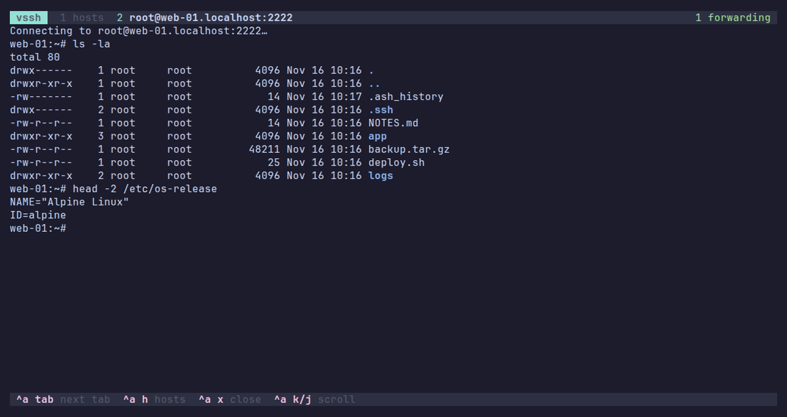
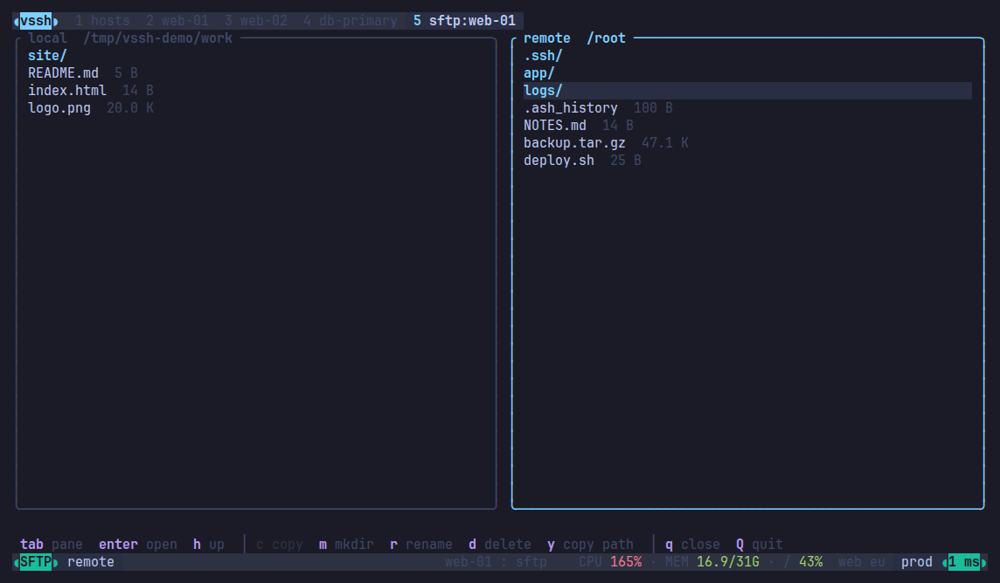

# vssh

[](https://github.com/DucLong06/vssh/actions/workflows/ci.yml)

**English** · [Tiếng Việt](#tiếng-việt)

A terminal SSH manager: host list on the left, details or a live session on
the right, vim keys everywhere. Hosts live in your normal `~/.ssh/config`, so
plain `ssh` keeps working with everything vssh edits.


- SSH sessions in tabs, with a built-in terminal emulator
- Quick connect to `user@host` without saving anything
- Dual-pane SFTP browser with a progress bar
- Local, remote and dynamic (SOCKS5) port forwards per host
- Encrypted password vault, command snippets, groups and tags, fuzzy search

| Host list and details | Quick connect |
|---|---|
|  |  |
| **Session** | **SFTP** |
|  |  |

The media are recorded from the real app by [`docs/img/demo.sh`](docs/img/demo.sh); the hosts in them are a local demo container.

Linux and macOS. Pure Rust SSH ([russh](https://github.com/warp-tech/russh)); no `ssh` binary needed.

## Build

Needs Rust 1.89+ and a C compiler (for the bundled SQLite).

```sh
cargo build --release
./target/release/vssh
```

## Quickstart: first connection

1. Start `vssh`. Every host in `~/.ssh/config` is listed. No hosts yet? Press `a` to add one (next section).
2. Move with `j` / `k`, press `Enter`. A shell opens in a new tab.
3. Login tries your SSH agent, then key files, then the vault password. If all are refused, vssh asks for a password once.
4. The first time you reach a host its key is saved to `~/.ssh/known_hosts`. If that key ever changes, vssh refuses to connect.
5. `Ctrl-a h` returns to the host list, `Ctrl-a x` closes the tab, `q` quits.

`r` checks which hosts answer: a green dot with the connect time, a red dot for hosts that are down, a hollow gray dot for hosts not checked yet.

## Quick connect

Press `c`, type `user@host` or `user@host:port`, optionally a password, and press `Enter`. A session opens in a tab. Nothing is saved: no entry in `~/.ssh/config`, no vault entry, no statistics; the password is used for that session only. The host key is still checked and recorded in `~/.ssh/known_hosts`, as with `ssh`.

## Adding a server

**From the TUI.** Press `a`, fill in the form (`Tab` moves between fields), press `Enter`:

| Field | Meaning |
|-------|---------|
| Alias | short name shown in the list |
| HostName | address or DNS name |
| User, Port, IdentityFile | optional; default to your user, 22, and your agent / default keys |
| Group, Tags, Notes | optional; kept by vssh only |

The host is written to `~/.ssh/config` as a normal `Host` block. `e` edits, `y` duplicates, `d` deletes.

**From `~/.ssh/config`.** Add a block and restart vssh (the file is read at startup):

```
Host web1
    HostName 203.0.113.10
    User deploy
    Port 2222
    IdentityFile ~/.ssh/id_ed25519
```

Comments, unknown options and `Host *` defaults are preserved. Before its first change vssh saves a copy as `~/.ssh/config.vssh.bak`.

## Groups and tags

Press `e` on a host and fill in **Group** (one name, e.g. `prod`) and **Tags** (separated by spaces or commas, e.g. `web eu`). Hosts are sorted pinned first, then by group; groups and tags are coloured.

| Type | Shows |
|------|-------|
| `/#web` | hosts with a tag or group starting with `web` |
| `/#` | every host that has a tag or group |
| `/web` | fuzzy match on alias, hostname, user, group and tags |

`Enter` keeps the filter, `Esc` clears it. Groups and tags are stored in vssh's own database, not in the ssh config.

## Keys

`?` shows this list inside vssh.

| Where | Key | Action |
|-------|-----|--------|
| Host list | `j` `k` `g` `G` | move, first, last |
| | `Enter` / `s` | open shell / SFTP browser |
| | `c` | quick connect (not saved) |
| | `/` | search (`#tag` for a tag or group) |
| | `a` `e` `d` `y` | add, edit, delete, duplicate host |
| | `p` / `Space` | pin / mark host (snippets run on all marked hosts) |
| | `f` / `n` | port forwards / snippets of the host |
| | `r` | check which hosts are reachable |
| | `P` / `V` | store a password in the vault / unlock or lock the vault |
| | `Tab` | next tab |
| | `q` or `Ctrl-c` | quit |
| Forwards, snippets | `a` `e` `d` | add, edit (snippets), delete |
| | `Enter` | start/stop the forward, run the snippet |
| | `Esc` | back |
| Any tab | `Ctrl-a` `Tab` / `p` | next / previous tab |
| | `Ctrl-a` `1`-`9` / `h` | go to tab / host list |
| | `Ctrl-a` `x` | close tab |
| | `Ctrl-a` `k` / `j` | scroll back / forward |
| | `Ctrl-a` `Ctrl-a` | send `Ctrl-a` to the remote |
| SFTP | `Tab` | switch pane (left local, right remote) |
| | `Enter` / `h` | open directory / parent |
| | `c` | copy file to the other pane |
| | `m` `r` `d` `R` | mkdir, rename, delete, refresh |
| | `q` | close |

A forward is typed like the `ssh` flags: `L 8080 localhost:80`, `R 9000 localhost:3000`, `D 1080`.

## Security

- **Host keys:** unknown hosts are recorded on first contact; a known host must present a recorded key, otherwise the connection is refused.
- **Vault:** `P` stores a host's password in `~/.local/share/vssh/vault` (mode 0600), encrypted with Argon2id + XChaCha20-Poly1305. There is no recovery if you lose the master passphrase.
- **Known advisory:** `cargo audit` reports [RUSTSEC-2023-0071](https://rustsec.org/advisories/RUSTSEC-2023-0071) (timing side channel in the `rsa` crate, pinned by russh). It affects signing with an RSA key *file*. Prefer Ed25519 keys, or keep RSA keys in `ssh-agent`. Details: `.cargo/audit.toml`.

## Files and configuration

| Path | Contents |
|------|----------|
| `~/.ssh/config`, `~/.ssh/known_hosts` | hosts, forwards, host keys (shared with OpenSSH) |
| `~/.local/share/vssh/vssh.db` | groups, tags, notes, pins, stats, snippets |
| `~/.local/share/vssh/vault` | encrypted passwords |
| `~/.config/vssh/config.toml` | optional theme and keys |

```toml
ping_on_start = false   # check every host at launch

[theme]                 # colour names or "#rrggbb"
accent = "cyan"         # also: border, text, dim, selection, ok, error, warn, bar, key

[keys]                  # one character each; leader is pressed with Ctrl
leader = "a"            # also: quit, search, sftp, connect, forwards, snippets, add,
quit = "q"              # edit, delete, duplicate, pin, mark, ping, password, vault, help
```

Entries you leave out keep their defaults, so a config written for an older version still works.

## Not supported yet

`ProxyJump` / `ProxyCommand`, `Include`, passphrase-protected key files (use the agent), keyboard-interactive / 2FA, copying directories over SFTP, Telnet and serial.

## Development

```sh
cargo fmt --check && cargo test && cargo clippy --all-targets -- -D warnings
cargo audit    # needs: cargo install cargo-audit
```

Design notes: [docs/PLAN.md](docs/PLAN.md).

## License

MIT. See [LICENSE](LICENSE).

---

# Tiếng Việt

[English](#vssh) · **Tiếng Việt**

Trình quản lý SSH chạy trong terminal: danh sách máy chủ bên trái, thông tin
chi tiết hoặc phiên làm việc bên phải, dùng phím kiểu vim ở mọi nơi. Máy chủ
được lưu ngay trong `~/.ssh/config` quen thuộc, nên lệnh `ssh` thông thường
vẫn dùng được mọi thứ vssh chỉnh sửa.


- Nhiều phiên SSH trong các tab, có sẵn trình giả lập terminal
- Kết nối nhanh tới `user@host` mà không lưu lại gì
- Trình duyệt SFTP hai khung, có thanh tiến độ
- Chuyển tiếp cổng local, remote và dynamic (SOCKS5) cho từng máy chủ
- Kho mật khẩu mã hoá, snippet lệnh, nhóm và thẻ (tag), tìm kiếm mờ

| Danh sách máy chủ và chi tiết | Kết nối nhanh |
|---|---|
|  |  |
| **Phiên làm việc** | **SFTP** |
|  |  |

Hình ảnh được ghi lại từ chính ứng dụng bằng [`docs/img/demo.sh`](docs/img/demo.sh); các máy chủ trong hình là một container demo chạy trên máy.

Chạy trên Linux và macOS. SSH viết thuần Rust ([russh](https://github.com/warp-tech/russh)); không cần chương trình `ssh`.

## Biên dịch

Cần Rust 1.89 trở lên và một trình biên dịch C (cho SQLite đi kèm).

```sh
cargo build --release
./target/release/vssh
```

## Bắt đầu nhanh: kết nối đầu tiên

1. Chạy `vssh`. Mọi máy chủ trong `~/.ssh/config` sẽ hiện ra. Chưa có máy chủ nào? Nhấn `a` để thêm (xem mục kế tiếp).
2. Di chuyển bằng `j` / `k`, nhấn `Enter`. Một shell mở ra trong tab mới.
3. Việc đăng nhập thử lần lượt SSH agent, các file khoá, rồi mật khẩu trong kho. Nếu tất cả bị từ chối, vssh hỏi mật khẩu một lần.
4. Lần đầu kết nối, khoá của máy chủ được lưu vào `~/.ssh/known_hosts`. Nếu sau này khoá đó thay đổi, vssh từ chối kết nối.
5. `Ctrl-a h` quay về danh sách máy chủ, `Ctrl-a x` đóng tab, `q` thoát.

`r` kiểm tra máy chủ nào phản hồi: chấm xanh kèm thời gian kết nối, chấm đỏ cho máy không kết nối được, chấm xám rỗng cho máy chưa kiểm tra.

## Kết nối nhanh

Nhấn `c`, gõ `user@host` hoặc `user@host:port`, có thể thêm mật khẩu, rồi nhấn `Enter`. Một phiên làm việc mở ra trong tab. Không có gì được lưu: không thêm vào `~/.ssh/config`, không lưu vào kho mật khẩu, không ghi thống kê; mật khẩu chỉ dùng cho phiên đó. Khoá máy chủ vẫn được kiểm tra và ghi vào `~/.ssh/known_hosts`, giống như `ssh`.

## Thêm máy chủ

**Trong giao diện.** Nhấn `a`, điền biểu mẫu (`Tab` để chuyển ô), rồi nhấn `Enter`:

| Ô | Ý nghĩa |
|---|---------|
| Alias | tên ngắn hiển thị trong danh sách |
| HostName | địa chỉ IP hoặc tên miền |
| User, Port, IdentityFile | không bắt buộc; mặc định là user hiện tại, cổng 22, và agent / các khoá mặc định |
| Group, Tags, Notes | không bắt buộc; chỉ vssh lưu |

Máy chủ được ghi vào `~/.ssh/config` thành một khối `Host` bình thường. `e` để sửa, `y` để nhân bản, `d` để xoá.

**Qua `~/.ssh/config`.** Thêm một khối rồi khởi động lại vssh (file được đọc lúc khởi động):

```
Host web1
    HostName 203.0.113.10
    User deploy
    Port 2222
    IdentityFile ~/.ssh/id_ed25519
```

Chú thích, các tuỳ chọn vssh không biết và phần mặc định `Host *` đều được giữ nguyên. Trước lần sửa đầu tiên, vssh lưu một bản sao tại `~/.ssh/config.vssh.bak`.

## Nhóm và thẻ

Nhấn `e` trên một máy chủ rồi điền **Group** (một tên, ví dụ `prod`) và **Tags** (cách nhau bằng dấu cách hoặc dấu phẩy, ví dụ `web eu`). Máy chủ được sắp xếp: đã ghim lên trước, sau đó theo nhóm; nhóm và thẻ được tô màu.

| Gõ | Hiển thị |
|----|----------|
| `/#web` | máy chủ có thẻ hoặc nhóm bắt đầu bằng `web` |
| `/#` | mọi máy chủ có thẻ hoặc nhóm |
| `/web` | tìm mờ theo alias, hostname, user, nhóm và thẻ |

`Enter` giữ bộ lọc, `Esc` xoá bộ lọc. Nhóm và thẻ nằm trong cơ sở dữ liệu riêng của vssh, không nằm trong ssh config.

## Phím tắt

Nhấn `?` trong vssh để xem danh sách này.

| Ở đâu | Phím | Tác dụng |
|-------|------|----------|
| Danh sách máy chủ | `j` `k` `g` `G` | di chuyển, về đầu, về cuối |
| | `Enter` / `s` | mở shell / trình duyệt SFTP |
| | `c` | kết nối nhanh (không lưu) |
| | `/` | tìm kiếm (`#tag` để lọc theo thẻ hoặc nhóm) |
| | `a` `e` `d` `y` | thêm, sửa, xoá, nhân bản máy chủ |
| | `p` / `Space` | ghim / đánh dấu máy chủ (snippet chạy trên mọi máy đã đánh dấu) |
| | `f` / `n` | chuyển tiếp cổng / snippet của máy chủ |
| | `r` | kiểm tra máy chủ nào kết nối được |
| | `P` / `V` | lưu mật khẩu vào kho / mở hoặc khoá kho |
| | `Tab` | tab kế tiếp |
| | `q` hoặc `Ctrl-c` | thoát |
| Chuyển tiếp cổng, snippet | `a` `e` `d` | thêm, sửa (snippet), xoá |
| | `Enter` | bật/tắt chuyển tiếp, chạy snippet |
| | `Esc` | quay lại |
| Trong mọi tab | `Ctrl-a` `Tab` / `p` | tab kế tiếp / tab trước |
| | `Ctrl-a` `1`-`9` / `h` | tới tab số đó / về danh sách máy chủ |
| | `Ctrl-a` `x` | đóng tab |
| | `Ctrl-a` `k` / `j` | cuộn lên / cuộn xuống |
| | `Ctrl-a` `Ctrl-a` | gửi `Ctrl-a` tới máy từ xa |
| SFTP | `Tab` | đổi khung (trái là máy mình, phải là máy từ xa) |
| | `Enter` / `h` | vào thư mục / lên thư mục cha |
| | `c` | chép file sang khung bên kia |
| | `m` `r` `d` `R` | tạo thư mục, đổi tên, xoá, tải lại |
| | `q` | đóng |

Chuyển tiếp cổng được gõ giống cờ của `ssh`: `L 8080 localhost:80`, `R 9000 localhost:3000`, `D 1080`.

## Bảo mật

- **Khoá máy chủ:** máy chủ chưa biết được ghi lại ở lần kết nối đầu; máy chủ đã biết phải đưa ra đúng khoá đã ghi, nếu không kết nối bị từ chối.
- **Kho mật khẩu:** `P` lưu mật khẩu của máy chủ vào `~/.local/share/vssh/vault` (quyền 0600), mã hoá bằng Argon2id + XChaCha20-Poly1305. Mất mật khẩu chủ thì không khôi phục được.
- **Cảnh báo đã biết:** `cargo audit` báo [RUSTSEC-2023-0071](https://rustsec.org/advisories/RUSTSEC-2023-0071) (kênh kề thời gian trong crate `rsa`, bị russh ghim phiên bản). Lỗi ảnh hưởng tới việc ký bằng *file* khoá RSA. Nên dùng khoá Ed25519, hoặc để khoá RSA trong `ssh-agent`. Chi tiết: `.cargo/audit.toml`.

## File và cấu hình

| Đường dẫn | Nội dung |
|-----------|----------|
| `~/.ssh/config`, `~/.ssh/known_hosts` | máy chủ, chuyển tiếp cổng, khoá máy chủ (dùng chung với OpenSSH) |
| `~/.local/share/vssh/vssh.db` | nhóm, thẻ, ghi chú, ghim, thống kê, snippet |
| `~/.local/share/vssh/vault` | mật khẩu đã mã hoá |
| `~/.config/vssh/config.toml` | giao diện màu và phím (không bắt buộc) |

```toml
ping_on_start = false   # kiểm tra mọi máy chủ khi khởi động

[theme]                 # tên màu hoặc "#rrggbb"
accent = "cyan"         # còn có: border, text, dim, selection, ok, error, warn, bar, key

[keys]                  # mỗi phím một ký tự; leader được nhấn cùng Ctrl
leader = "a"            # còn có: quit, search, sftp, connect, forwards, snippets, add,
quit = "q"              # edit, delete, duplicate, pin, mark, ping, password, vault, help
```

Mục nào bỏ trống sẽ dùng giá trị mặc định, nên file cấu hình viết cho phiên bản cũ vẫn dùng được.

## Chưa hỗ trợ

`ProxyJump` / `ProxyCommand`, `Include`, file khoá có mật khẩu bảo vệ (hãy dùng agent), keyboard-interactive / 2FA, chép thư mục qua SFTP, Telnet và serial.

## Phát triển

```sh
cargo fmt --check && cargo test && cargo clippy --all-targets -- -D warnings
cargo audit    # cần: cargo install cargo-audit
```

Ghi chú thiết kế: [docs/PLAN.md](docs/PLAN.md).

## Giấy phép

MIT. Xem file [LICENSE](LICENSE).
