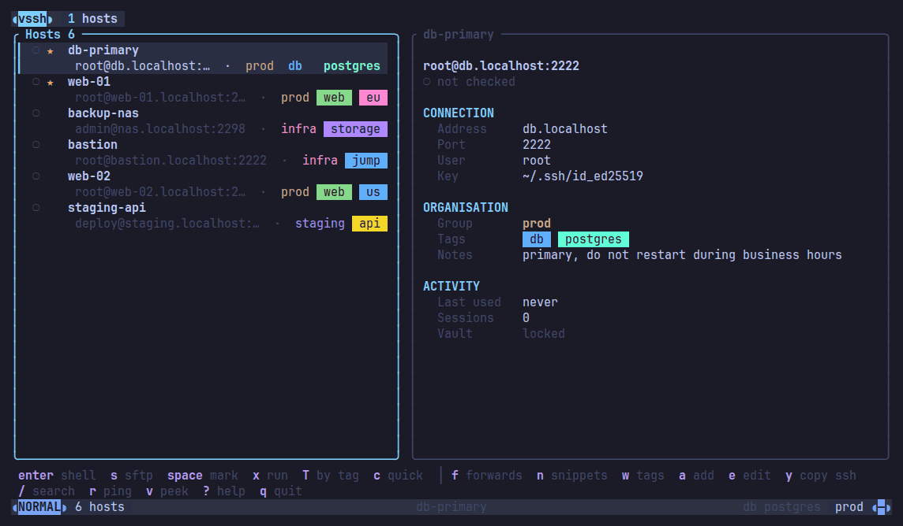
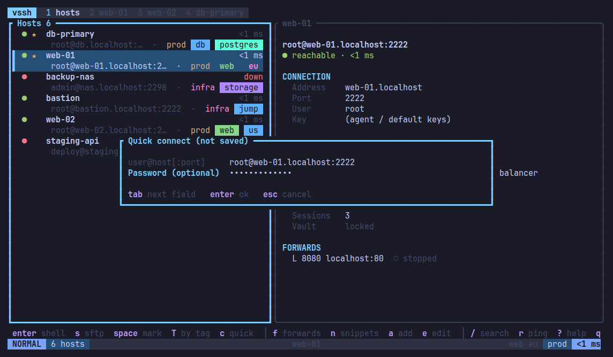

# vssh

[](https://github.com/DucLong06/vssh/actions/workflows/ci.yml)

**English** · [Tiếng Việt](#tiếng-việt)

A terminal SSH manager: host list on the left, details or a live session on
the right, vim keys everywhere. Hosts live in your normal `~/.ssh/config`, so
plain `ssh` keeps working with everything vssh edits.



- SSH sessions in tabs, with a built-in terminal emulator
- Several hosts side by side in split panes, and broadcast: type once, run everywhere
- Quick connect to `user@host` without saving anything
- Dual-pane SFTP browser with a progress bar
- Local, remote and dynamic (SOCKS5) port forwards per host
- Encrypted password vault, command snippets, groups and tags, fuzzy search
- Session logs, login scripts, English or Vietnamese interface

| Host list and details | Broadcast to three hosts |
|---|---|
|  |  |
| **Leader menu (`Ctrl-a`)** | **SFTP** |
|  |  |

The pictures are captured from the real app by [`docs/img/demo.sh`](docs/img/demo.sh) (terminal contents rendered to images); the hosts in them are a local demo container.

Linux and macOS. Pure Rust SSH ([russh](https://github.com/warp-tech/russh)); no `ssh` binary needed.

## Install

```sh
curl -fsSL https://raw.githubusercontent.com/DucLong06/vssh/main/install.sh | sh
```

Installs to `~/.local/bin` (`--prefix DIR` changes that); run it again to update. It uses a release binary when one exists for your machine and otherwise builds with `cargo`. The installer speaks English or Vietnamese, chosen from your locale; force it with `sh -s -- --lang vi` or `VSSH_LANG=vi`.

## Build

Needs Rust 1.89+ and a C compiler (for the bundled SQLite).

```sh
cargo build --release
./target/release/vssh        # or: sh install.sh, from the checkout
```

## Quickstart: first connection

1. Start `vssh`. Every host in `~/.ssh/config` is listed. No hosts yet? Press `a` to add one (next section).
2. Move with `j` / `k`, press `Enter`. A shell opens in a new tab.
3. Login tries your SSH agent, then key files, then the vault password. If all are refused, vssh asks for a password once.
4. The first time you reach a host its key is saved to `~/.ssh/known_hosts`. If that key ever changes, vssh refuses to connect.
5. `Ctrl-a q` returns to the host list, `Ctrl-a x` closes the session, `q` quits. After `Ctrl-a` a menu shows every key you can press next.

`r` checks which hosts answer: a green dot with the connect time, a red dot for hosts that are down, a hollow gray dot for hosts not checked yet.

## Quick connect

Press `c`, type `user@host` or `user@host:port`, optionally a password, and press `Enter`. A session opens in a tab. Nothing is saved: no entry in `~/.ssh/config`, no vault entry, no statistics; the password is used for that session only. The host key is still checked and recorded in `~/.ssh/known_hosts`, as with `ssh`.



## Many hosts at once

- **Open several:** mark hosts with `Space`, then `Enter` opens a session on each. Or press `T`, type a tag or group, and every host with it is connected.
- **Layouts:** the sessions appear side by side. `Ctrl-a L` cycles single, 2 columns, 2x2 grid, 3 columns; `Ctrl-a w` then `s` `v` `g` `t` picks one directly. With more sessions than panes, the view follows the focused one.
- **Focus:** `Alt-h/j/k/l` moves between panes like vim windows (also `Ctrl-a` + arrow). `Ctrl-a d` closes the focused session.
- **Broadcast:** `Alt-b` (or `Ctrl-a b`). While it is on, what you type or paste goes to *every* connected session, including ones not on screen. The status line turns orange and shows how many sessions are listening, and their panes get an orange border. Press `Alt-b` again to stop.
- **Snippets:** `Ctrl-a s` types a saved snippet into the session, or into all of them while broadcasting.

## Session logs and login scripts

- **Log a session:** `Ctrl-a l` starts and stops a log in `~/.local/share/vssh/logs/<host>-<date>-<time>.log` (mode 0600). It holds everything the terminal shows, raw and unmasked, so passwords that are printed end up in it; read it with `less -R`. `log_sessions = true` in the config logs every session.
- **Login script:** list a command under `[exec]` in `config.toml` and it is typed into the shell right after login. `RemoteCommand` in `~/.ssh/config` is honoured too: it runs *instead of* the shell, as with `ssh`.

## Adding a server

**From the TUI.** Press `a`, fill in the form (`Tab` moves between fields), press `Enter`:

| Field | Meaning |
|-------|---------|
| Alias | short name shown in the list |
| HostName | address or DNS name |
| User, Port, IdentityFile | optional; default to your user, 22, and your agent / default keys |
| Group, Tags, Notes | optional; kept by vssh only |

The host is written to `~/.ssh/config` as a normal `Host` block. `e` edits, `y` duplicates, `d` deletes.

**From `~/.ssh/config`.** Add a block and restart vssh (the file is read at startup):

```
Host web1
    HostName 203.0.113.10
    User deploy
    Port 2222
    IdentityFile ~/.ssh/id_ed25519
```

Comments, unknown options and `Host *` defaults are preserved. Before its first change vssh saves a copy as `~/.ssh/config.vssh.bak`.

## Groups and tags

Press `e` on a host and fill in **Group** (one name, e.g. `prod`) and **Tags** (separated by spaces or commas, e.g. `web eu`). Hosts are sorted pinned first, then by group; groups and tags are coloured.

| Type | Shows |
|------|-------|
| `/#web` | hosts with a tag or group starting with `web` |
| `/#` | every host that has a tag or group |
| `/web` | fuzzy match on alias, hostname, user, group and tags |

`Enter` keeps the filter, `Esc` clears it. Groups and tags are stored in vssh's own database, not in the ssh config.

## Keys

`?` shows this list inside vssh.

| Where | Key | Action |
|-------|-----|--------|
| Host list | `j` `k` `g` `G` | move, first, last |
| | `Ctrl-d` / `Ctrl-u` | half a screen down / up |
| | `Enter` / `s` | open shell / SFTP browser |
| | `Space`, then `Enter` | mark hosts, then open a session on every marked host |
| | `T` | connect to every host with a tag or group |
| | `c` | quick connect (not saved) |
| | `/` | search (`#tag` for a tag or group); `Esc` clears |
| | `a` `e` `d` `y` | add, edit, delete, duplicate host |
| | `p` | pin host |
| | `f` / `n` | port forwards / snippets of the host |
| | `r` | check which hosts are reachable |
| | `P` / `V` | store a password in the vault / unlock or lock the vault |
| | `Tab` / `Shift-Tab` | next / previous tab |
| | `?` | help |
| | `q`, `Q` or `Ctrl-c` | quit |
| Forwards, snippets | `a` `e` `d` | add, edit (snippets), delete |
| | `Enter` | start/stop the forward, run the snippet |
| | `Esc` | back |
| Sessions | `Alt-b` or `Ctrl-a` `b` | broadcast typing to all sessions, on / off |
| | `Alt-h` `j` `k` `l` | focus the pane left / below / above / right |
| | `Ctrl-a` `L` | next layout: single, 2 columns, 2x2, 3 columns |
| | `Ctrl-a` `w` | window menu: `h` `j` `k` `l` focus, `s` `v` `g` `t` layout, `d` close |
| | `Ctrl-a` `l` | log the session to a file, on / off |
| | `Ctrl-a` `s` | type a snippet into the session |
| | `Ctrl-a` `d` or `x` | close the session |
| | `Ctrl-a` `q` | back to the host list |
| | `Ctrl-a` `Tab` / `p`, `1`-`9` | next / previous tab, go to tab |
| | `Ctrl-a` `PgUp` / `PgDn` | scroll back / forward (also `Ctrl-u` / `Ctrl-d`) |
| | `Ctrl-a` `Ctrl-a` | send `Ctrl-a` to the remote |
| SFTP | `Tab` | switch pane (left local, right remote) |
| | `Enter` / `h` | open directory / parent |
| | `c` | copy file to the other pane |
| | `m` `r` `d` `R` | mkdir, rename, delete, refresh |
| | `q` / `Q` | close / quit |

`Alt-b` and, while several panes are shown, `Alt-h/j/k/l` are taken by vssh and no longer reach the remote shell. Coming from an older version: `Ctrl-a h` (host list) is now `Ctrl-a q`, and `Ctrl-a k` / `j` (scroll) are now `Ctrl-a PgUp` / `PgDn`.

A forward is typed like the `ssh` flags: `L 8080 localhost:80`, `R 9000 localhost:3000`, `D 1080`.

## Security

- **Host keys:** unknown hosts are recorded on first contact; a known host must present a recorded key, otherwise the connection is refused.
- **Vault:** `P` stores a host's password in `~/.local/share/vssh/vault` (mode 0600), encrypted with Argon2id + XChaCha20-Poly1305. There is no recovery if you lose the master passphrase.
- **Known advisory:** `cargo audit` reports [RUSTSEC-2023-0071](https://rustsec.org/advisories/RUSTSEC-2023-0071) (timing side channel in the `rsa` crate, pinned by russh). It affects signing with an RSA key *file*. Prefer Ed25519 keys, or keep RSA keys in `ssh-agent`. Details: `.cargo/audit.toml`.

## Files and configuration

| Path | Contents |
|------|----------|
| `~/.ssh/config`, `~/.ssh/known_hosts` | hosts, forwards, host keys (shared with OpenSSH) |
| `~/.local/share/vssh/vssh.db` | groups, tags, notes, pins, stats, snippets |
| `~/.local/share/vssh/vault` | encrypted passwords |
| `~/.local/share/vssh/logs/` | session logs, when you turn them on |
| `~/.config/vssh/config.toml` | optional settings, theme and keys |

```toml
lang = "en"             # "vi" for Vietnamese key hints, menus and help
ping_on_start = false   # check every host at launch
log_sessions = false    # log every session from the start

[exec]                  # login scripts: typed into the shell after login
web-01 = "cd /srv/app && git status"

[theme]                 # colour names or "#rrggbb"
accent = "cyan"         # also: border, text, dim, selection, ok, error, warn, bar, key

[keys]                  # one character each; leader is pressed with Ctrl
leader = "a"            # also: quit, search, sftp, connect, connect_tag, forwards, snippets,
quit = "q"              # add, edit, delete, duplicate, pin, mark, ping, password, vault, help
```

Entries you leave out keep their defaults, so a config written for an older version still works. The language can also be set per run with `vssh --lang vi` or `VSSH_LANG=vi`; forms and error messages stay in English.

## Not supported

`ProxyJump` / `ProxyCommand`, `Include`, passphrase-protected key files (use the agent), keyboard-interactive / 2FA, copying directories over SFTP, Telnet, serial, Zmodem, X11 forwarding, mouse. The reasons are in [docs/PLAN.md](docs/PLAN.md#not-planned).

## Development

```sh
cargo fmt --check && cargo test && cargo clippy --all-targets -- -D warnings
cargo audit    # needs: cargo install cargo-audit
```

Design notes: [docs/PLAN.md](docs/PLAN.md).

## License

MIT. See [LICENSE](LICENSE).

---

# Tiếng Việt

[English](#vssh) · **Tiếng Việt**

Trình quản lý SSH chạy trong terminal: danh sách máy chủ bên trái, thông tin
chi tiết hoặc phiên làm việc bên phải, dùng phím kiểu vim ở mọi nơi. Máy chủ
được lưu ngay trong `~/.ssh/config` quen thuộc, nên lệnh `ssh` thông thường
vẫn dùng được mọi thứ vssh chỉnh sửa.


- Nhiều phiên SSH trong các tab, có sẵn trình giả lập terminal
- Nhiều máy chủ cạnh nhau trong các khung chia, và chế độ phát (broadcast): gõ một lần, chạy trên mọi máy
- Kết nối nhanh tới `user@host` mà không lưu lại gì
- Trình duyệt SFTP hai khung, có thanh tiến độ
- Chuyển tiếp cổng local, remote và dynamic (SOCKS5) cho từng máy chủ
- Kho mật khẩu mã hoá, snippet lệnh, nhóm và thẻ (tag), tìm kiếm mờ
- Ghi log phiên, script đăng nhập, giao diện tiếng Anh hoặc tiếng Việt

| Danh sách máy chủ và chi tiết | Phát tới ba máy chủ |
|---|---|
|  |  |
| **Menu leader (`Ctrl-a`)** | **SFTP** |
|  |  |

Hình ảnh được chụp từ chính ứng dụng bằng [`docs/img/demo.sh`](docs/img/demo.sh) (nội dung terminal được dựng thành ảnh); các máy chủ trong hình là một container demo chạy trên máy.

Chạy trên Linux và macOS. SSH viết thuần Rust ([russh](https://github.com/warp-tech/russh)); không cần chương trình `ssh`.

## Cài đặt

```sh
curl -fsSL https://raw.githubusercontent.com/DucLong06/vssh/main/install.sh | sh -s -- --lang vi
```

Cài vào `~/.local/bin` (đổi bằng `--prefix THƯ_MỤC`); chạy lại để cập nhật. Trình cài đặt dùng bản dựng sẵn nếu có cho máy của bạn, nếu không sẽ biên dịch bằng `cargo`. Thông báo hiện bằng tiếng Anh hoặc tiếng Việt theo locale của máy; ép chọn bằng `--lang vi` hoặc `VSSH_LANG=vi`.

## Biên dịch

Cần Rust 1.89 trở lên và một trình biên dịch C (cho SQLite đi kèm).

```sh
cargo build --release
./target/release/vssh        # hoặc: sh install.sh, ngay trong thư mục mã nguồn
```

## Bắt đầu nhanh: kết nối đầu tiên

1. Chạy `vssh`. Mọi máy chủ trong `~/.ssh/config` sẽ hiện ra. Chưa có máy chủ nào? Nhấn `a` để thêm (xem mục kế tiếp).
2. Di chuyển bằng `j` / `k`, nhấn `Enter`. Một shell mở ra trong tab mới.
3. Việc đăng nhập thử lần lượt SSH agent, các file khoá, rồi mật khẩu trong kho. Nếu tất cả bị từ chối, vssh hỏi mật khẩu một lần.
4. Lần đầu kết nối, khoá của máy chủ được lưu vào `~/.ssh/known_hosts`. Nếu sau này khoá đó thay đổi, vssh từ chối kết nối.
5. `Ctrl-a q` quay về danh sách máy chủ, `Ctrl-a x` đóng phiên, `q` thoát. Sau khi nhấn `Ctrl-a`, một menu hiện ra mọi phím có thể nhấn tiếp.

`r` kiểm tra máy chủ nào phản hồi: chấm xanh kèm thời gian kết nối, chấm đỏ cho máy không kết nối được, chấm xám rỗng cho máy chưa kiểm tra.

## Kết nối nhanh

Nhấn `c`, gõ `user@host` hoặc `user@host:port`, có thể thêm mật khẩu, rồi nhấn `Enter`. Một phiên làm việc mở ra trong tab. Không có gì được lưu: không thêm vào `~/.ssh/config`, không lưu vào kho mật khẩu, không ghi thống kê; mật khẩu chỉ dùng cho phiên đó. Khoá máy chủ vẫn được kiểm tra và ghi vào `~/.ssh/known_hosts`, giống như `ssh`.


## Nhiều máy chủ cùng lúc

- **Mở nhiều máy:** đánh dấu các máy bằng `Space`, rồi `Enter` mở một phiên trên từng máy. Hoặc nhấn `T`, gõ một thẻ hay nhóm, mọi máy có thẻ đó sẽ được kết nối.
- **Bố cục:** các phiên hiện cạnh nhau. `Ctrl-a L` đổi lần lượt: một khung, 2 cột, lưới 2x2, 3 cột; `Ctrl-a w` rồi `s` `v` `g` `t` để chọn thẳng. Khi số phiên nhiều hơn số khung, màn hình đi theo phiên đang được chọn.
- **Chuyển khung:** `Alt-h/j/k/l` di chuyển giữa các khung như cửa sổ vim (hoặc `Ctrl-a` + phím mũi tên). `Ctrl-a d` đóng phiên đang chọn.
- **Phát (broadcast):** `Alt-b` (hoặc `Ctrl-a b`). Khi bật, những gì bạn gõ hay dán sẽ được gửi tới *mọi* phiên đang kết nối, kể cả phiên không hiện trên màn hình. Thanh trạng thái chuyển sang màu cam và cho biết có bao nhiêu phiên đang nhận, các khung đó có viền cam. Nhấn `Alt-b` lần nữa để tắt.
- **Snippet:** `Ctrl-a s` gõ một snippet đã lưu vào phiên, hoặc vào mọi phiên khi đang phát.

## Ghi log phiên và script đăng nhập

- **Ghi log một phiên:** `Ctrl-a l` bật và tắt việc ghi vào `~/.local/share/vssh/logs/<máy>-<ngày>-<giờ>.log` (quyền 0600). File chứa mọi thứ terminal hiển thị, nguyên văn và không che gì, nên mật khẩu nào bị in ra cũng nằm trong đó; đọc bằng `less -R`. Đặt `log_sessions = true` trong file cấu hình để ghi mọi phiên.
- **Script đăng nhập:** khai báo một lệnh trong mục `[exec]` của `config.toml`, lệnh sẽ được gõ vào shell ngay sau khi đăng nhập. `RemoteCommand` trong `~/.ssh/config` cũng được tôn trọng: lệnh đó chạy *thay cho* shell, giống `ssh`.

## Thêm máy chủ

**Trong giao diện.** Nhấn `a`, điền biểu mẫu (`Tab` để chuyển ô), rồi nhấn `Enter`:

| Ô | Ý nghĩa |
|---|---------|
| Alias | tên ngắn hiển thị trong danh sách |
| HostName | địa chỉ IP hoặc tên miền |
| User, Port, IdentityFile | không bắt buộc; mặc định là user hiện tại, cổng 22, và agent / các khoá mặc định |
| Group, Tags, Notes | không bắt buộc; chỉ vssh lưu |

Máy chủ được ghi vào `~/.ssh/config` thành một khối `Host` bình thường. `e` để sửa, `y` để nhân bản, `d` để xoá.

**Qua `~/.ssh/config`.** Thêm một khối rồi khởi động lại vssh (file được đọc lúc khởi động):

```
Host web1
    HostName 203.0.113.10
    User deploy
    Port 2222
    IdentityFile ~/.ssh/id_ed25519
```

Chú thích, các tuỳ chọn vssh không biết và phần mặc định `Host *` đều được giữ nguyên. Trước lần sửa đầu tiên, vssh lưu một bản sao tại `~/.ssh/config.vssh.bak`.

## Nhóm và thẻ

Nhấn `e` trên một máy chủ rồi điền **Group** (một tên, ví dụ `prod`) và **Tags** (cách nhau bằng dấu cách hoặc dấu phẩy, ví dụ `web eu`). Máy chủ được sắp xếp: đã ghim lên trước, sau đó theo nhóm; nhóm và thẻ được tô màu.

| Gõ | Hiển thị |
|----|----------|
| `/#web` | máy chủ có thẻ hoặc nhóm bắt đầu bằng `web` |
| `/#` | mọi máy chủ có thẻ hoặc nhóm |
| `/web` | tìm mờ theo alias, hostname, user, nhóm và thẻ |

`Enter` giữ bộ lọc, `Esc` xoá bộ lọc. Nhóm và thẻ nằm trong cơ sở dữ liệu riêng của vssh, không nằm trong ssh config.

## Phím tắt

Nhấn `?` trong vssh để xem danh sách này.

| Ở đâu | Phím | Tác dụng |
|-------|------|----------|
| Danh sách máy chủ | `j` `k` `g` `G` | di chuyển, về đầu, về cuối |
| | `Ctrl-d` / `Ctrl-u` | xuống / lên nửa màn hình |
| | `Enter` / `s` | mở shell / trình duyệt SFTP |
| | `Space`, rồi `Enter` | đánh dấu các máy, rồi mở phiên trên mọi máy đã đánh dấu |
| | `T` | kết nối mọi máy có cùng thẻ hoặc nhóm |
| | `c` | kết nối nhanh (không lưu) |
| | `/` | tìm kiếm (`#tag` để lọc theo thẻ hoặc nhóm); `Esc` để xoá |
| | `a` `e` `d` `y` | thêm, sửa, xoá, nhân bản máy chủ |
| | `p` | ghim máy chủ |
| | `f` / `n` | chuyển tiếp cổng / snippet của máy chủ |
| | `r` | kiểm tra máy chủ nào kết nối được |
| | `P` / `V` | lưu mật khẩu vào kho / mở hoặc khoá kho |
| | `Tab` / `Shift-Tab` | tab kế tiếp / tab trước |
| | `?` | trợ giúp |
| | `q`, `Q` hoặc `Ctrl-c` | thoát |
| Chuyển tiếp cổng, snippet | `a` `e` `d` | thêm, sửa (snippet), xoá |
| | `Enter` | bật/tắt chuyển tiếp, chạy snippet |
| | `Esc` | quay lại |
| Phiên làm việc | `Alt-b` hoặc `Ctrl-a` `b` | bật / tắt phát: gõ tới mọi phiên |
| | `Alt-h` `j` `k` `l` | chọn khung bên trái / dưới / trên / phải |
| | `Ctrl-a` `L` | bố cục kế tiếp: một khung, 2 cột, 2x2, 3 cột |
| | `Ctrl-a` `w` | menu cửa sổ: `h` `j` `k` `l` chọn khung, `s` `v` `g` `t` bố cục, `d` đóng |
| | `Ctrl-a` `l` | bật / tắt ghi log phiên ra file |
| | `Ctrl-a` `s` | gõ một snippet vào phiên |
| | `Ctrl-a` `d` hoặc `x` | đóng phiên |
| | `Ctrl-a` `q` | về danh sách máy chủ |
| | `Ctrl-a` `Tab` / `p`, `1`-`9` | tab kế tiếp / tab trước, tới tab số đó |
| | `Ctrl-a` `PgUp` / `PgDn` | cuộn lên / cuộn xuống (hoặc `Ctrl-u` / `Ctrl-d`) |
| | `Ctrl-a` `Ctrl-a` | gửi `Ctrl-a` tới máy từ xa |
| SFTP | `Tab` | đổi khung (trái là máy mình, phải là máy từ xa) |
| | `Enter` / `h` | vào thư mục / lên thư mục cha |
| | `c` | chép file sang khung bên kia |
| | `m` `r` `d` `R` | tạo thư mục, đổi tên, xoá, tải lại |
| | `q` / `Q` | đóng / thoát |

`Alt-b` và, khi đang hiện nhiều khung, `Alt-h/j/k/l` do vssh xử lý nên không còn tới shell ở máy từ xa. Nếu bạn dùng bản cũ: `Ctrl-a h` (về danh sách máy chủ) nay là `Ctrl-a q`, còn `Ctrl-a k` / `j` (cuộn) nay là `Ctrl-a PgUp` / `PgDn`.

Chuyển tiếp cổng được gõ giống cờ của `ssh`: `L 8080 localhost:80`, `R 9000 localhost:3000`, `D 1080`.

## Bảo mật

- **Khoá máy chủ:** máy chủ chưa biết được ghi lại ở lần kết nối đầu; máy chủ đã biết phải đưa ra đúng khoá đã ghi, nếu không kết nối bị từ chối.
- **Kho mật khẩu:** `P` lưu mật khẩu của máy chủ vào `~/.local/share/vssh/vault` (quyền 0600), mã hoá bằng Argon2id + XChaCha20-Poly1305. Mất mật khẩu chủ thì không khôi phục được.
- **Cảnh báo đã biết:** `cargo audit` báo [RUSTSEC-2023-0071](https://rustsec.org/advisories/RUSTSEC-2023-0071) (kênh kề thời gian trong crate `rsa`, bị russh ghim phiên bản). Lỗi ảnh hưởng tới việc ký bằng *file* khoá RSA. Nên dùng khoá Ed25519, hoặc để khoá RSA trong `ssh-agent`. Chi tiết: `.cargo/audit.toml`.

## File và cấu hình

| Đường dẫn | Nội dung |
|-----------|----------|
| `~/.ssh/config`, `~/.ssh/known_hosts` | máy chủ, chuyển tiếp cổng, khoá máy chủ (dùng chung với OpenSSH) |
| `~/.local/share/vssh/vssh.db` | nhóm, thẻ, ghi chú, ghim, thống kê, snippet |
| `~/.local/share/vssh/vault` | mật khẩu đã mã hoá |
| `~/.local/share/vssh/logs/` | log phiên, khi bạn bật ghi log |
| `~/.config/vssh/config.toml` | thiết lập, màu và phím (không bắt buộc) |

```toml
lang = "vi"             # "vi": gợi ý phím, menu và trợ giúp bằng tiếng Việt; mặc định "en"
ping_on_start = false   # kiểm tra mọi máy chủ khi khởi động
log_sessions = false    # ghi log mọi phiên ngay từ đầu

[exec]                  # script đăng nhập: được gõ vào shell sau khi đăng nhập
web-01 = "cd /srv/app && git status"

[theme]                 # tên màu hoặc "#rrggbb"
accent = "cyan"         # còn có: border, text, dim, selection, ok, error, warn, bar, key

[keys]                  # mỗi phím một ký tự; leader được nhấn cùng Ctrl
leader = "a"            # còn có: quit, search, sftp, connect, connect_tag, forwards, snippets,
quit = "q"              # add, edit, delete, duplicate, pin, mark, ping, password, vault, help
```

Mục nào bỏ trống sẽ dùng giá trị mặc định, nên file cấu hình viết cho phiên bản cũ vẫn dùng được. Cũng có thể chọn ngôn ngữ cho từng lần chạy bằng `vssh --lang vi` hoặc `VSSH_LANG=vi`; các biểu mẫu và thông báo lỗi vẫn bằng tiếng Anh.

## Không hỗ trợ

`ProxyJump` / `ProxyCommand`, `Include`, file khoá có mật khẩu bảo vệ (hãy dùng agent), keyboard-interactive / 2FA, chép thư mục qua SFTP, Telnet, serial, Zmodem, chuyển tiếp X11, chuột. Lý do nằm trong [docs/PLAN.md](docs/PLAN.md#not-planned).

## Phát triển

```sh
cargo fmt --check && cargo test && cargo clippy --all-targets -- -D warnings
cargo audit    # cần: cargo install cargo-audit
```

Ghi chú thiết kế: [docs/PLAN.md](docs/PLAN.md).

## Giấy phép

MIT. Xem file [LICENSE](LICENSE).
