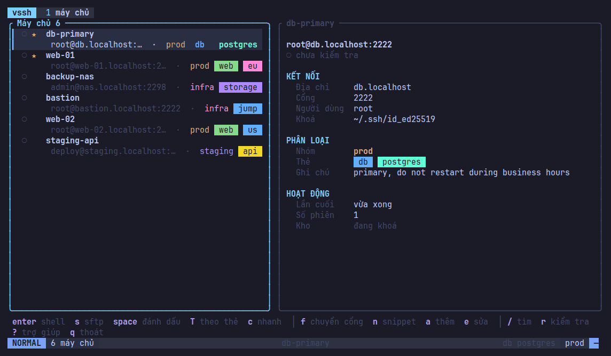
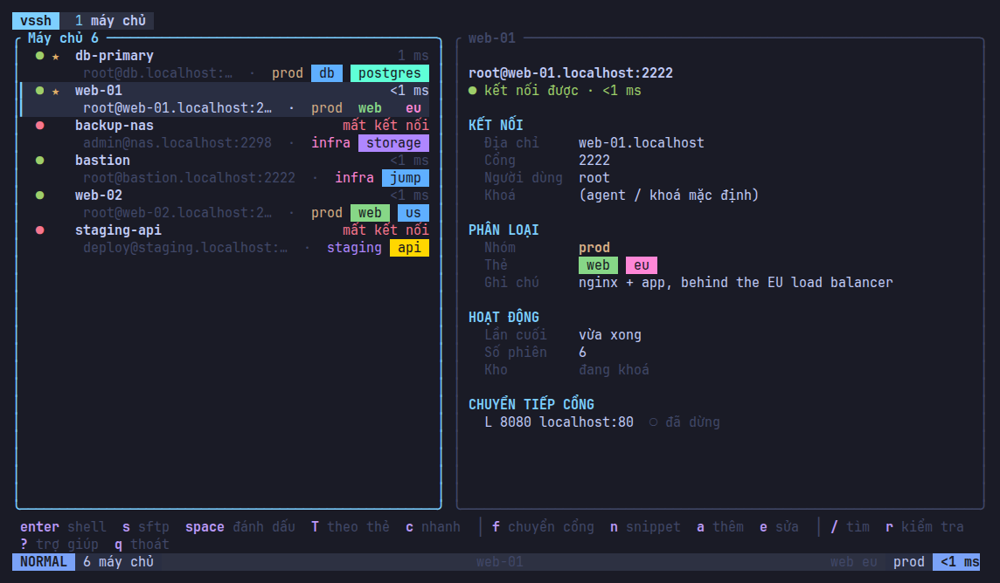
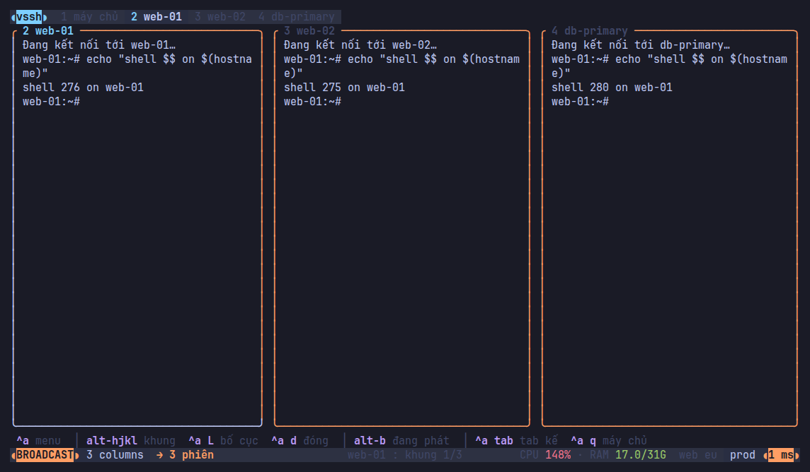
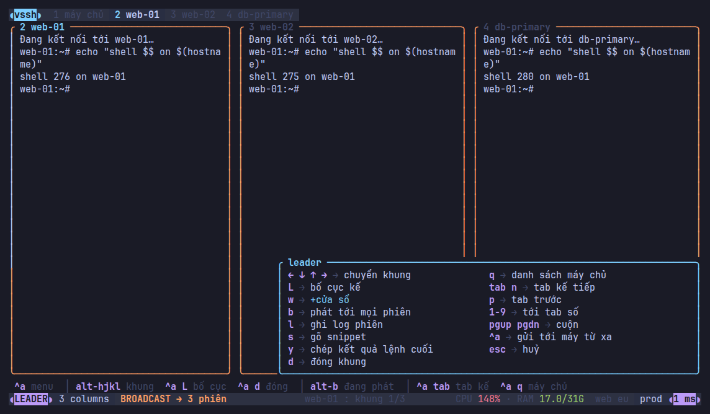
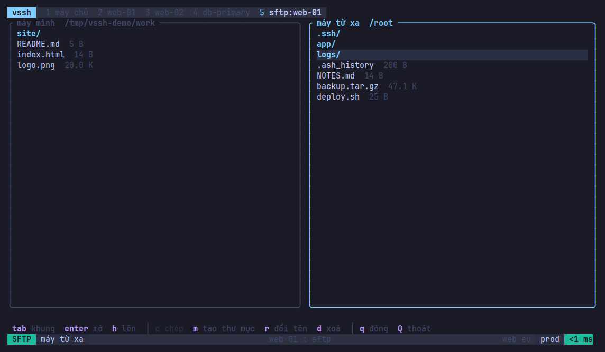
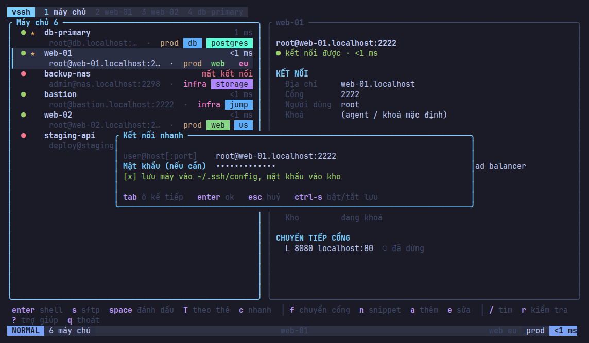

# Tiếng Việt

**Tiếng Việt** · [English](README.md)

Trình quản lý SSH chạy trong terminal: danh sách máy chủ bên trái, thông tin
chi tiết hoặc phiên làm việc bên phải, dùng phím kiểu vim ở mọi nơi. Máy chủ
được lưu ngay trong `~/.ssh/config` quen thuộc, nên lệnh `ssh` thông thường
vẫn dùng được mọi thứ vssh chỉnh sửa.



- Nhiều phiên SSH trong các tab, có sẵn trình giả lập terminal
- Nhiều máy chủ cạnh nhau trong các khung chia, và chế độ phát (broadcast): gõ một lần, chạy trên mọi máy
- Kết nối nhanh tới `user@host`, có thể lưu hoặc không lưu máy chủ và mật khẩu
- Trình duyệt SFTP hai khung, có thanh tiến độ
- Chuyển tiếp cổng local, remote và dynamic (SOCKS5) cho từng máy chủ
- Kho mật khẩu mã hoá, snippet lệnh, nhóm và thẻ (tag), tìm kiếm mờ
- Ghi log phiên, script đăng nhập, giao diện tiếng Anh hoặc tiếng Việt

| Danh sách máy chủ và chi tiết | Phát tới ba máy chủ |
|---|---|
|  |  |
| **Menu leader (`Ctrl-a`)** | **SFTP** |
|  |  |

Mọi hình ảnh được chụp từ chính ứng dụng bằng [`docs/img/demo.sh`](docs/img/demo.sh) (nội dung terminal được dựng thành ảnh), bằng ngôn ngữ giao diện tiếng Việt; các máy chủ trong hình là một container demo chạy trên máy.

Chạy trên Linux và macOS. SSH viết thuần Rust ([russh](https://github.com/warp-tech/russh)); không cần chương trình `ssh`.

## Cài đặt

```sh
curl -fsSL https://raw.githubusercontent.com/DucLong06/vssh/main/install.sh | sh -s -- --lang vi
```

Cài vào `~/.local/bin` (đổi bằng `--prefix THƯ_MỤC`); chạy lại để cập nhật. Trình cài đặt dùng bản dựng sẵn nếu có cho máy của bạn, nếu không sẽ biên dịch bằng `cargo`. Thông báo hiện bằng tiếng Anh hoặc tiếng Việt theo locale của máy; ép chọn bằng `--lang vi` hoặc `VSSH_LANG=vi`.

## Biên dịch

Cần Rust 1.89 trở lên và một trình biên dịch C (cho SQLite đi kèm).

```sh
cargo build --release
./target/release/vssh        # hoặc: sh install.sh, ngay trong thư mục mã nguồn
```

## Bắt đầu nhanh: kết nối đầu tiên

1. Chạy `vssh`. Mọi máy chủ trong `~/.ssh/config` sẽ hiện ra. Chưa có máy chủ nào? Nhấn `a` để thêm (xem mục kế tiếp).
2. Di chuyển bằng `j` / `k`, nhấn `Enter`. Một shell mở ra trong tab mới.
3. Việc đăng nhập thử lần lượt SSH agent, các file khoá, rồi mật khẩu trong kho. Nếu tất cả bị từ chối, vssh hỏi mật khẩu một lần.
4. Lần đầu kết nối, khoá của máy chủ được lưu vào `~/.ssh/known_hosts`. Nếu sau này khoá đó thay đổi, vssh từ chối kết nối.
5. `Ctrl-a q` quay về danh sách máy chủ, `Ctrl-a x` đóng phiên, `q` thoát. Sau khi nhấn `Ctrl-a`, một menu hiện ra mọi phím có thể nhấn tiếp.

`r` kiểm tra máy chủ nào phản hồi: chấm xanh kèm thời gian kết nối, chấm đỏ cho máy không kết nối được, chấm xám rỗng cho máy chưa kiểm tra.

## Kết nối nhanh

Nhấn `c`, gõ `user@host` hoặc `user@host:port`, có thể thêm mật khẩu, rồi nhấn `Enter`. Một phiên làm việc mở ra trong tab. Không có gì được lưu: không thêm vào `~/.ssh/config`, không lưu vào kho mật khẩu, không ghi thống kê; mật khẩu chỉ dùng cho phiên đó. Khoá máy chủ vẫn được kiểm tra và ghi vào `~/.ssh/known_hosts`, giống như `ssh`.

**Lưu ngay khi kết nối.** Đánh dấu ô chọn trong biểu mẫu bằng `Ctrl-s` (hoặc `Tab` tới ô đó rồi nhấn `S`), sau đó nhấn `Enter`:

- máy chủ được thêm vào `~/.ssh/config` như mọi máy chủ khác. Alias là tên máy, hoặc `user@host` nếu tên đó đã được dùng;
- mật khẩu bạn đã gõ được lưu vào kho mật khẩu dưới alias đó, mã hoá như mọi mật khẩu trong kho. Nếu kho đang khoá, vssh hỏi mật khẩu chủ (hoặc tạo kho mới); nếu bạn huỷ bước này thì mật khẩu bị bỏ đi, không được lưu;
- mật khẩu không bao giờ được ghi vào `~/.ssh/config` hay `config.toml`.

Khi con trỏ đang ở ô nhập chữ, phím `S` đơn không thể dùng để bật/tắt vì đó là một chữ cái bạn có thể cần gõ; vì vậy phím tắt là `Ctrl-s`.



## Nhiều máy chủ cùng lúc

- **Mở nhiều máy:** đánh dấu các máy bằng `Space`, rồi `Enter` mở một phiên trên từng máy. Hoặc nhấn `T`, gõ một thẻ hay nhóm, mọi máy có thẻ đó sẽ được kết nối.
- **Mọi tỷ lệ màn hình:** bố cục tự theo màn hình terminal — cạnh nhau khi rộng, xếp chồng chiếm hết chiều rộng khi cao (điện thoại chạy Termux, màn hình dọc), từng bảng một khi không đủ chỗ. Ép bằng `layout = "landscape"|"portrait"` trong cấu hình.
- **Bố cục:** các phiên hiện cạnh nhau. `Ctrl-a L` đổi lần lượt: một khung, 2 cột, lưới 2x2, 3 cột; `Ctrl-a w` rồi `s` `v` `g` `t` để chọn thẳng. Khi số phiên nhiều hơn số khung, màn hình đi theo phiên đang được chọn.
- **Chuyển khung:** `Alt-h/j/k/l` di chuyển giữa các khung như cửa sổ vim (hoặc `Ctrl-a` + phím mũi tên). `Ctrl-a d` đóng phiên đang chọn.
- **Phát (broadcast):** `Alt-b` (hoặc `Ctrl-a b`). Khi bật, những gì bạn gõ hay dán sẽ được gửi tới *mọi* phiên đang kết nối, kể cả phiên không hiện trên màn hình. Thanh trạng thái chuyển sang màu cam và cho biết có bao nhiêu phiên đang nhận, các khung đó có viền cam. Nhấn `Alt-b` lần nữa để tắt.
- **Snippet:** `Ctrl-a s` gõ một snippet đã lưu vào phiên, hoặc vào mọi phiên khi đang phát.

## Thanh trạng thái

Dòng dưới cùng hiện chế độ, máy chủ và khung đang chọn, rồi tới thẻ, nhóm và độ trễ. Ở cửa sổ rộng, nó còn cho biết tình trạng của máy chủ:

```
 TERMINAL  single          web-01 : khung 1/1          CPU ▂ 23% · RAM ▂ 4.2/16G · / ▅ 61%   web  prod  12 ms
```

- **CPU** là tải trung bình 1 phút chia cho số nhân (trên 100% nghĩa là việc đang phải xếp hàng), **RAM** là bộ nhớ đã dùng / tổng, **/** là mức đầy của phân vùng gốc. Mỗi số chuyển sang vàng rồi đỏ: CPU trên 50% / 80%, bộ nhớ trên 70% / 85%, đĩa trên 80% / 90%.
- **Trong một phiên**, số liệu được đọc mỗi 5 giây qua một kênh thứ hai của chính kết nối đang mở: không đăng nhập thêm lần nào. Hỗ trợ máy chủ Linux (`/proc`) và macOS (`uptime`, `vm_stat`); máy không trả lời thì không hiện gì.
- **Ở danh sách máy chủ**, dừng con trỏ trên một máy trong giây lát thì máy đó được hỏi một lần. Chỉ hỏi máy bạn đã từng kết nối (khoá của nó đã có trong `known_hosts`), và chỉ dùng agent hoặc file khoá: mật khẩu trong kho không bao giờ được gửi cho việc này. Máy đang có phiên mở thì dùng số liệu của phiên đó; máy đã từ chối thì không bị hỏi lại.
- **Khi thiếu chỗ:** bỏ thanh nhỏ trước, rồi tới đĩa, rồi bộ nhớ. Màn hình dọc và cửa sổ nhỏ chỉ giữ chế độ và máy chủ.
- `status_stats = false` trong file cấu hình sẽ tắt toàn bộ.
- **Nhãn bo tròn:** chế độ, độ trễ và chữ `vssh` là các nhãn có hai đầu nửa hình tròn (`◖NORMAL◗`). Nếu dùng Nerd Font, đặt `nerd_font = true` để dùng đầu bo Powerline cao trọn dòng; không có font đó thì chúng hiện thành ô trống, nên mặc định là tắt.
- **Chuyển tab:** tab được chuyển tới trượt vào từ bên phải trong ba khung hình (120 ms). Terminal từ xa không bị đổi kích thước trong lúc trượt. Trên đường truyền chậm, ba lần vẽ lại là ba lượt gửi nhận: đặt `transitions = false` để tắt.

## Chép vào clipboard

vssh không dùng thư viện clipboard nào. Nó nhờ chính terminal đang chạy nó chép giúp, bằng chuỗi thoát OSC 52, nên vẫn dùng được khi bạn SSH vào máy đang chạy vssh.

- **Danh sách máy chủ:** `y` chép `ssh <máy>`.
- **Phiên làm việc:** `Ctrl-a y` chép kết quả của lệnh cuối: các dòng nằm giữa dấu nhắc bạn đang đứng và dấu nhắc trước đó. Nếu hai dấu nhắc không giống hệt nhau (có đồng hồ trong đó, hoặc bạn đã gõ dở), mọi thứ phía trên con trỏ sẽ được chép. Chỉ tính những gì đang hiện trên màn hình. Phím là `Ctrl-a y` chứ không phải `y`, vì `y` trần là của shell.
- **SFTP:** `y` chép đường dẫn đầy đủ của file đang chọn.
- **Terminal hỗ trợ:** hầu hết terminal hiện nay nhận OSC 52 (có cái hỏi trước hoặc cần bật). Trong tmux, vssh còn đưa văn bản cho chính tmux (`tmux load-buffer -w`), vì tmux bỏ qua OSC 52 của chương trình trừ khi `set-clipboard on`. `osc52 = false` tắt chuỗi thoát cho terminal in nó ra thay vì thực hiện; bộ đệm tmux vẫn được đặt.

## Xem nhanh

Nhấn `v` ở danh sách máy chủ để mở một cửa sổ nhỏ cho biết máy đó tự nói gì về mình: tên máy, hệ thống (`uname -srm`), thời gian đã chạy, ba chỉ số tải trung bình, CPU, bộ nhớ và đĩa gốc. Không mở shell nào: chỉ là một lệnh qua một kết nối ngắn, với cùng cách kiểm tra khoá máy chủ và đăng nhập như một phiên (agent, khoá, rồi mật khẩu trong kho).

- Câu trả lời được giữ 30 giây, nên mở lại cửa sổ là có ngay; `r` hoặc `Enter` để hỏi lại, `Esc` hoặc `q` để đóng.
- Mục nào máy không trả lời thì hiện dấu gạch; phần còn lại vẫn hiện. Nếu kết nối thất bại, cửa sổ cho biết vì sao, theo cách diễn đạt ở mục kế tiếp.

## Khi kết nối thất bại

vssh cho biết vì sao, không chỉ báo là thất bại. Một hộp thoại hiện lý do cùng toàn bộ chuỗi lỗi; phần chi tiết của máy chủ giữ lỗi gần nhất, màu đỏ, cho tới khi kết nối được.

| Hiển thị | Chuyện gì đã xảy ra |
|----------|---------------------|
| `DNS` Không phân giải được tên db.internal: … | tra tên thất bại; theo sau là nguyên văn lỗi của bộ phân giải |
| `HẾT GIỜ` Hết thời gian kết nối sau 10 giây (203.0.113.7:22) | không có gì trả lời ở địa chỉ đó |
| `BỊ TỪ CHỐI` 203.0.113.7:22 từ chối kết nối — sshd có đang chạy không? | máy có trả lời, nhưng không có gì nghe ở cổng đó |
| `KHÔNG TỚI ĐƯỢC` Không tới được 203.0.113.7:22: … | không có đường đi; theo sau là nguyên văn lỗi của hệ thống |
| `XÁC THỰC` Sai mật khẩu / Khoá công khai bị từ chối / Không có cách đăng nhập | máy chủ từ chối cách nào; sau đó bạn được hỏi mật khẩu |
| `KHOÁ MÁY CHỦ` Khoá máy chủ … không khớp | dấu vân tay máy chủ gửi, và dòng trong `known_hosts` mà nó xung đột |
| `LỖI` … | mọi lỗi khác, hiện nguyên văn |

Snippet chạy trên nhiều máy và chuyển tiếp cổng báo lỗi bằng cùng cách diễn đạt.

## Ghi log phiên và script đăng nhập

- **Ghi log một phiên:** `Ctrl-a l` bật và tắt việc ghi vào `~/.local/share/vssh/logs/<máy>-<ngày>-<giờ>.log` (quyền 0600). File chứa mọi thứ terminal hiển thị, nguyên văn và không che gì, nên mật khẩu nào bị in ra cũng nằm trong đó; đọc bằng `less -R`. Đặt `log_sessions = true` trong file cấu hình để ghi mọi phiên.
- **Script đăng nhập:** khai báo một lệnh trong mục `[exec]` của `config.toml`, lệnh sẽ được gõ vào shell ngay sau khi đăng nhập. `RemoteCommand` trong `~/.ssh/config` cũng được tôn trọng: lệnh đó chạy *thay cho* shell, giống `ssh`.

## Thêm máy chủ

**Trong giao diện.** Nhấn `a`, điền biểu mẫu (`Tab` để chuyển ô), rồi nhấn `Enter`:

| Ô | Ý nghĩa |
|---|---------|
| Alias | tên ngắn hiển thị trong danh sách |
| HostName | địa chỉ IP hoặc tên miền |
| User, Port, IdentityFile | không bắt buộc; mặc định là user hiện tại, cổng 22, và agent / các khoá mặc định |
| Group, Tags, Notes | không bắt buộc; chỉ vssh lưu |

Máy chủ được ghi vào `~/.ssh/config` thành một khối `Host` bình thường. `e` để sửa, `y` để nhân bản, `d` để xoá.

**Qua `~/.ssh/config`.** Thêm một khối rồi khởi động lại vssh (file được đọc lúc khởi động):

```
Host web1
    HostName 203.0.113.10
    User deploy
    Port 2222
    IdentityFile ~/.ssh/id_ed25519
```

Chú thích, các tuỳ chọn vssh không biết và phần mặc định `Host *` đều được giữ nguyên. Trước lần sửa đầu tiên, vssh lưu một bản sao tại `~/.ssh/config.vssh.bak`.

## Nhóm và thẻ

Nhấn `e` trên một máy chủ rồi điền **Group** (một tên, ví dụ `prod`) và **Tags** (cách nhau bằng dấu cách hoặc dấu phẩy, ví dụ `web eu`). Máy chủ được sắp xếp: đã ghim lên trước, sau đó theo nhóm; nhóm và thẻ được tô màu.

| Gõ | Hiển thị |
|----|----------|
| `/#web` | máy chủ có thẻ hoặc nhóm bắt đầu bằng `web` |
| `/#` | mọi máy chủ có thẻ hoặc nhóm |
| `/web` | tìm mờ theo alias, hostname, user, nhóm và thẻ |

`Enter` giữ bộ lọc, `Esc` xoá bộ lọc. Nhóm và thẻ nằm trong cơ sở dữ liệu riêng của vssh, không nằm trong ssh config.

## Phím tắt

Nhấn `?` trong vssh để xem danh sách này.

| Ở đâu | Phím | Tác dụng |
|-------|------|----------|
| Danh sách máy chủ | `j` `k` `g` `G` | di chuyển, về đầu, về cuối |
| | `Ctrl-d` / `Ctrl-u` | xuống / lên nửa màn hình |
| | `Enter` / `s` | mở shell / trình duyệt SFTP |
| | `Space`, rồi `Enter` | đánh dấu các máy, rồi mở phiên trên mọi máy đã đánh dấu |
| | `T` | kết nối mọi máy có cùng thẻ hoặc nhóm |
| | `c` | kết nối nhanh; `Ctrl-s` trong biểu mẫu để lưu máy chủ và mật khẩu |
| | `/` | tìm kiếm (`#tag` để lọc theo thẻ hoặc nhóm); `Esc` để xoá |
| | `a` `e` `d` `Y` | thêm, sửa, xoá, nhân bản máy chủ |
| | `y` | chép `ssh <máy>` vào clipboard |
| | `p` | ghim máy chủ |
| | `f` / `n` | chuyển tiếp cổng / snippet của máy chủ |
| | `r` | kiểm tra máy chủ nào kết nối được |
| | `v` | xem nhanh: uptime, tải, bộ nhớ và đĩa của máy, không cần mở phiên |
| | `P` / `V` | lưu mật khẩu vào kho / mở hoặc khoá kho |
| | `Tab` / `Shift-Tab` | tab kế tiếp / tab trước |
| | `?` | trợ giúp |
| | `q`, `Q` hoặc `Ctrl-c` | thoát |
| Chuyển tiếp cổng, snippet | `a` `e` `d` | thêm, sửa (snippet), xoá |
| | `Enter` | bật/tắt chuyển tiếp, chạy snippet |
| | `Esc` | quay lại |
| Phiên làm việc | `Alt-b` hoặc `Ctrl-a` `b` | bật / tắt phát: gõ tới mọi phiên |
| | `Alt-h` `j` `k` `l` | chọn khung bên trái / dưới / trên / phải |
| | `Ctrl-a` `L` | bố cục kế tiếp: một khung, 2 cột, 2x2, 3 cột |
| | `Ctrl-a` `w` | menu cửa sổ: `h` `j` `k` `l` chọn khung, `s` `v` `g` `t` bố cục, `d` đóng |
| | `Ctrl-a` `l` | bật / tắt ghi log phiên ra file |
| | `Ctrl-a` `s` | gõ một snippet vào phiên |
| | `Ctrl-a` `y` | chép kết quả của lệnh cuối vào clipboard |
| | `Ctrl-a` `d` hoặc `x` | đóng phiên |
| | `Ctrl-a` `q` | về danh sách máy chủ |
| | `Ctrl-a` `Tab` / `p`, `1`-`9` | tab kế tiếp / tab trước, tới tab số đó |
| | `Ctrl-a` `PgUp` / `PgDn` | cuộn lên / cuộn xuống (hoặc `Ctrl-u` / `Ctrl-d`) |
| | `Ctrl-a` `Ctrl-a` | gửi `Ctrl-a` tới máy từ xa |
| SFTP | `Tab` | đổi khung (trái là máy mình, phải là máy từ xa) |
| | `Enter` / `h` | vào thư mục / lên thư mục cha |
| | `c` | chép file sang khung bên kia |
| | `m` `r` `d` `R` | tạo thư mục, đổi tên, xoá, tải lại |
| | `y` | chép đường dẫn của file đang chọn vào clipboard |
| | `q` / `Q` | đóng / thoát |

`Alt-b` và, khi đang hiện nhiều khung, `Alt-h/j/k/l` do vssh xử lý nên không còn tới shell ở máy từ xa. Nếu bạn dùng bản cũ: `Ctrl-a h` (về danh sách máy chủ) nay là `Ctrl-a q`, `Ctrl-a k` / `j` (cuộn) nay là `Ctrl-a PgUp` / `PgDn`, còn nhân bản chuyển từ `y` sang `Y` vì `y` nay là chép (file cấu hình có `duplicate = "y"` thì vẫn giữ nguyên).

Chuyển tiếp cổng được gõ giống cờ của `ssh`: `L 8080 localhost:80`, `R 9000 localhost:3000`, `D 1080`.

## Bảo mật

- **Khoá máy chủ:** máy chủ chưa biết được ghi lại ở lần kết nối đầu; máy chủ đã biết phải đưa ra đúng khoá đã ghi, nếu không kết nối bị từ chối.
- **Kho mật khẩu:** `P` lưu mật khẩu của máy chủ vào `~/.local/share/vssh/vault` (quyền 0600), mã hoá bằng Argon2id + XChaCha20-Poly1305. Mất mật khẩu chủ thì không khôi phục được.
- **Cảnh báo đã biết:** `cargo audit` báo [RUSTSEC-2023-0071](https://rustsec.org/advisories/RUSTSEC-2023-0071) (kênh kề thời gian trong crate `rsa`, bị russh ghim phiên bản). Lỗi ảnh hưởng tới việc ký bằng *file* khoá RSA. Nên dùng khoá Ed25519, hoặc để khoá RSA trong `ssh-agent`. Chi tiết: `.cargo/audit.toml`.

## File và cấu hình

| Đường dẫn | Nội dung |
|-----------|----------|
| `~/.ssh/config`, `~/.ssh/known_hosts` | máy chủ, chuyển tiếp cổng, khoá máy chủ (dùng chung với OpenSSH) |
| `~/.local/share/vssh/vssh.db` | nhóm, thẻ, ghi chú, ghim, thống kê, snippet |
| `~/.local/share/vssh/vault` | mật khẩu đã mã hoá |
| `~/.local/share/vssh/logs/` | log phiên, khi bạn bật ghi log |
| `~/.config/vssh/config.toml` | thiết lập, màu và phím (không bắt buộc) |

```toml
lang = "vi"             # "vi": gợi ý phím, menu và trợ giúp bằng tiếng Việt; mặc định "en"
ping_on_start = false   # kiểm tra mọi máy chủ khi khởi động
log_sessions = false    # ghi log mọi phiên ngay từ đầu
status_stats = true     # tải, bộ nhớ và đĩa của máy đang chọn trên thanh trạng thái
nerd_font = false       # true: đầu bo Powerline cho các nhãn (cần Nerd Font)
transitions = true      # tab trượt vào trong ba khung hình khi chuyển tab
osc52 = true            # chép qua chuỗi thoát OSC 52 của terminal

[exec]                  # script đăng nhập: được gõ vào shell sau khi đăng nhập
web-01 = "cd /srv/app && git status"

[theme]                 # tên màu hoặc "#rrggbb"
accent = "cyan"         # còn có: border, text, dim, selection, ok, error, warn, bar, key

[keys]                  # mỗi phím một ký tự; leader được nhấn cùng Ctrl
leader = "a"            # còn có: quit, search, sftp, connect, connect_tag, forwards, snippets,
quit = "q"              # add, edit, delete, duplicate, copy, pin, mark, ping, peek, password, vault, help
```

Mục nào bỏ trống sẽ dùng giá trị mặc định, nên file cấu hình viết cho phiên bản cũ vẫn dùng được. Cũng có thể chọn ngôn ngữ cho từng lần chạy bằng `vssh --lang vi` hoặc `VSSH_LANG=vi`; các biểu mẫu và thông báo lỗi vẫn bằng tiếng Anh.

## Không hỗ trợ

`ProxyJump` / `ProxyCommand`, `Include`, file khoá có mật khẩu bảo vệ (hãy dùng agent), keyboard-interactive / 2FA, chép thư mục qua SFTP, Telnet, serial, Zmodem, chuyển tiếp X11, chuột. Lý do nằm trong [docs/PLAN.md](docs/PLAN.md#not-planned).

## Phát triển

```sh
cargo fmt --check && cargo test && cargo clippy --all-targets -- -D warnings
cargo audit    # cần: cargo install cargo-audit
```

Ghi chú thiết kế: [docs/PLAN.md](docs/PLAN.md).

## Giấy phép

MIT. Xem file [LICENSE](LICENSE).
