<p align="center">
  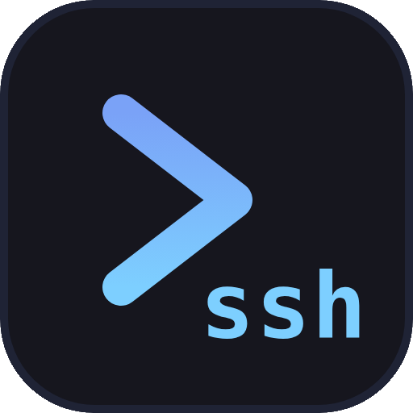
</p>

<p align="center"><b>Việt Nam SSH</b> — chữ V trong vssh là Việt Nam 🇻🇳<br>
Trình quản lý SSH đúng cách bạn làm việc: chọn máy chủ, kết nối, giữ nhiều phiên,
chép file, quản lý chuyển tiếp cổng — mà vẫn giữ nguyên `~/.ssh/config` quen
thuộc.</p>

<p align="center">Làm tại Việt Nam, bằng tiếng Việt và tiếng Anh</p>

<p align="center"><a href="README.vi.md">Tiếng Việt</a> · <a href="README.md">English</a> · Ứng dụng terminal: <a href="README-terminal.vi.md">README-terminal.vi.md</a> · <a href="README-terminal.md">README-terminal.md</a></p>

[](https://github.com/DucLong06/vssh/actions/workflows/ci.yml)

Một lõi Rust, hai giao diện. **Ứng dụng desktop** là giao diện chính, và trang
này viết về nó. **Ứng dụng terminal** là lựa chọn thứ hai: cùng một lõi, dùng
phím kiểu vim, được mô tả trong [README-terminal.vi.md](README-terminal.vi.md)
([English](README-terminal.md)). Cả hai đọc chung `~/.ssh/config`, chung cơ sở
dữ liệu và chung kho mật khẩu, cùng theme TokyoNight.

SSH viết thuần Rust ([russh](https://github.com/warp-tech/russh)); không cần chương trình `ssh`. Ứng dụng desktop chạy trên Linux x86_64, ứng dụng terminal chạy trên Linux và macOS.

## Ứng dụng desktop

Các máy chủ của bạn trong một cửa sổ: bảng điều khiển gồm các thẻ máy chủ với số liệu trực tiếp, các tab terminal có chế độ phát, trình duyệt SFTP hai khung, đoạn lệnh, chạy lệnh hàng loạt, chuyển tiếp cổng và kho mật khẩu.

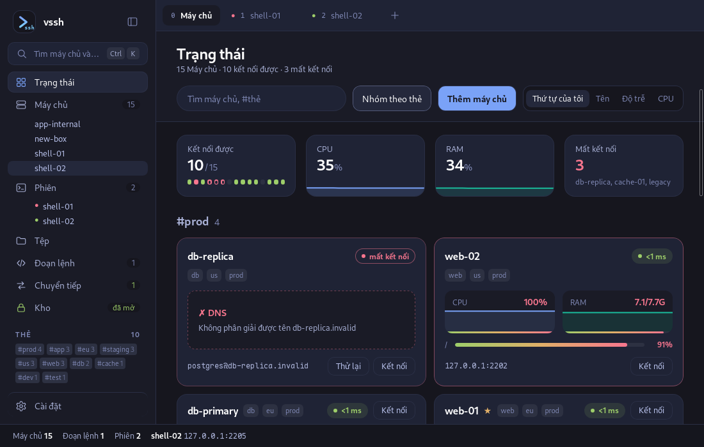

| Xem nhanh | Tab terminal, đang phát |
|---|---|
| 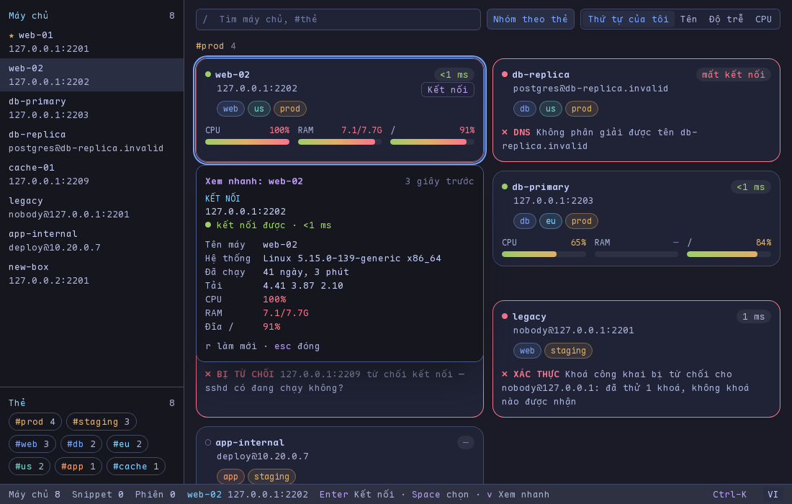 | 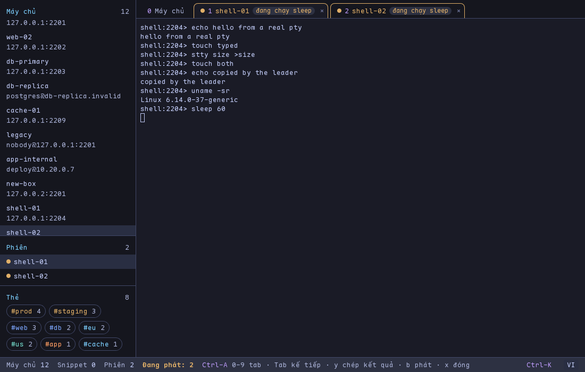 |
| **Hai ô, một bàn phím** | **Mọi phím tắt** |
| 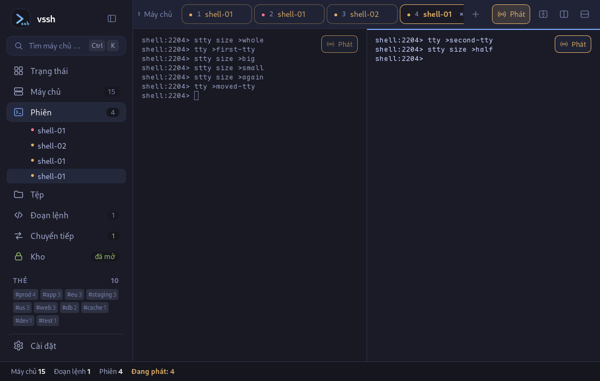 | 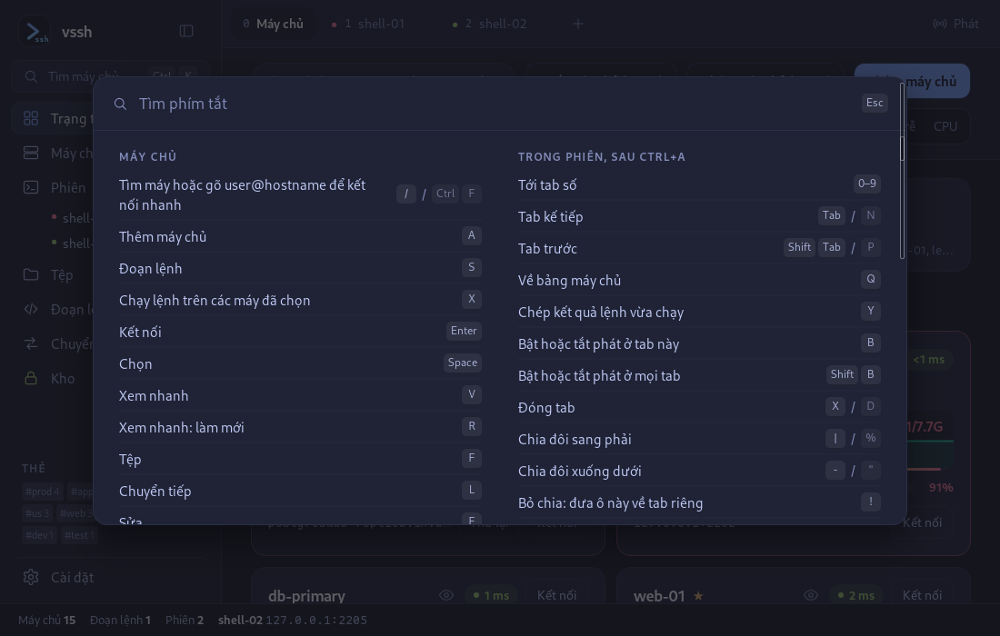 |
| **Tệp: máy mình và máy chủ** | **Một lệnh trên bốn máy** |
| 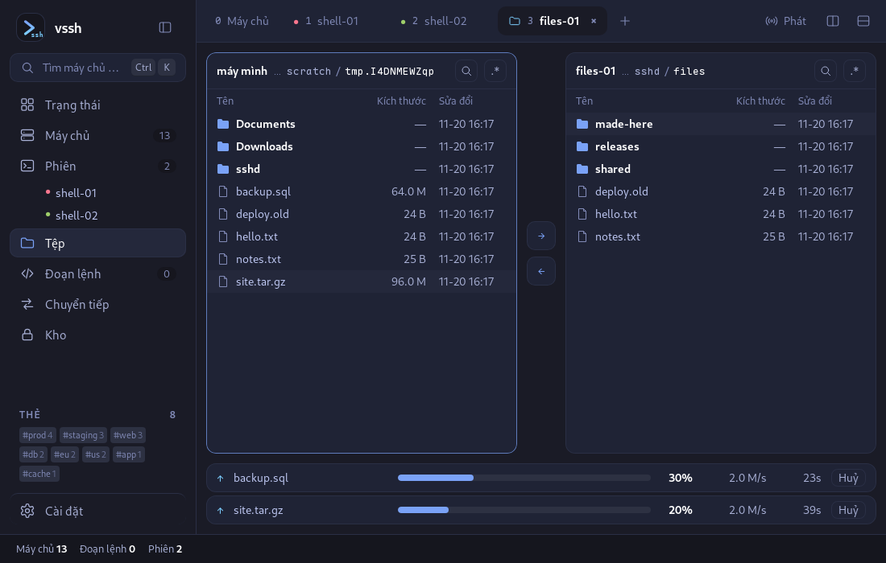 | 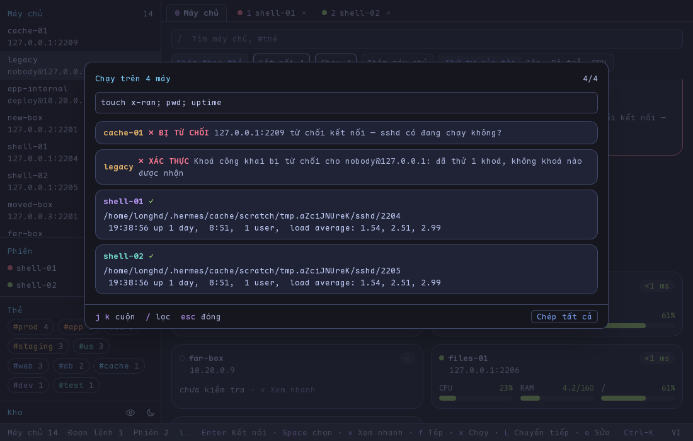 |
| **Biểu mẫu máy chủ** | **Kho mật khẩu** |
| 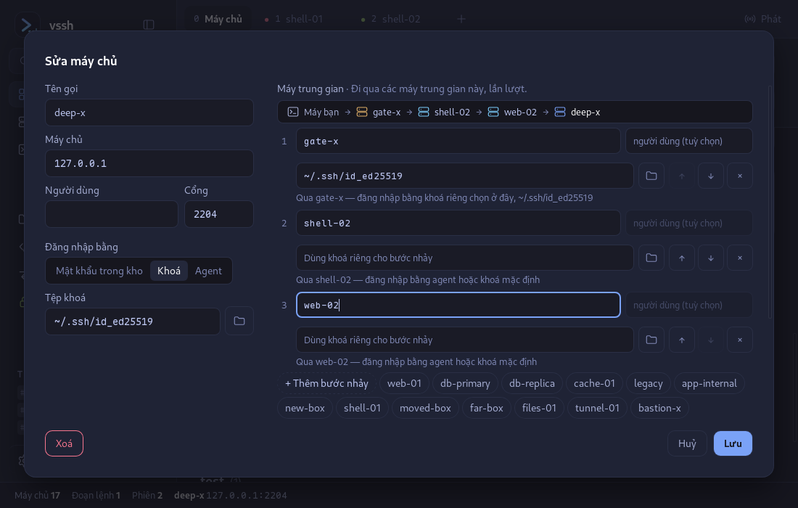 | 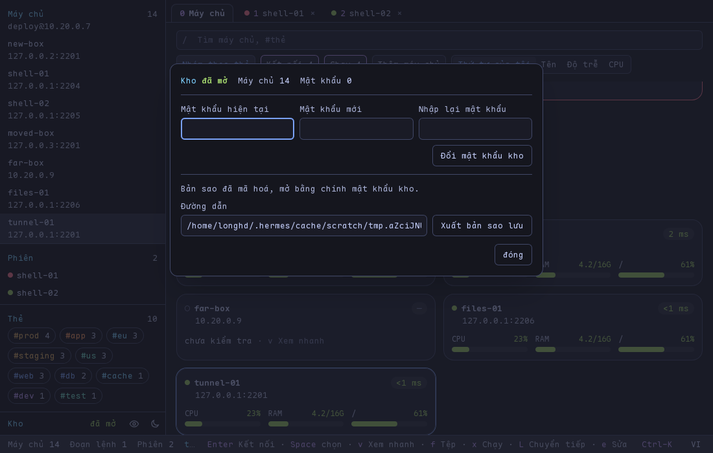 |
| **Giao diện Sáng** | **Chế độ phát trực tiếp** |
| 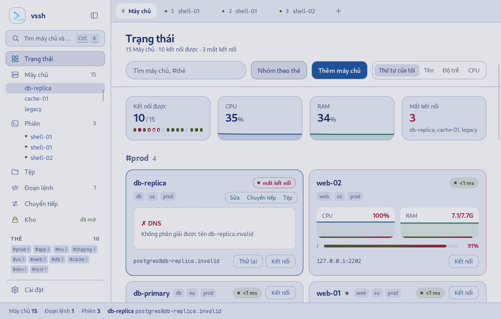 | 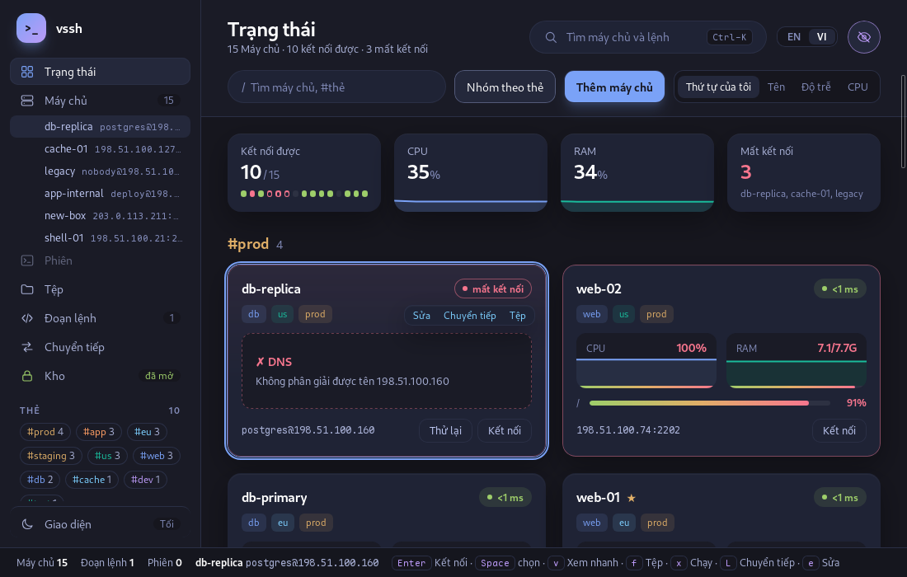 |
| **Cửa sổ ở mức 125 phần trăm** | |
| 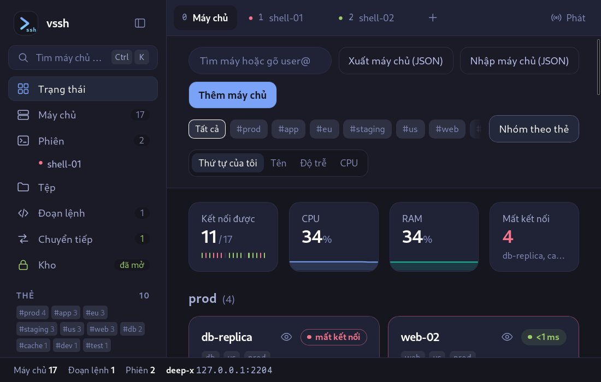 | |

Mọi hình ảnh được chụp từ chính ứng dụng bằng [`scripts/gui-smoke.sh`](scripts/gui-smoke.sh), bằng ngôn ngữ giao diện tiếng Việt; các máy chủ trong hình là một `sshd` tạm chạy ngay trên máy.

## Tính năng

- **Bảng điều khiển.** Mỗi máy chủ trong `~/.ssh/config` là một thẻ ở giữa cửa sổ: tên máy, `user@host`, các thẻ (tag), nhãn độ trễ, sparkline CPU và bộ nhớ của phút vừa qua, một thanh cho đĩa gốc. Thanh điều hướng bên trái không liệt kê máy nào: nó dẫn tới các màn hình và đếm số lượng. Phía trên là một hàng số liệu: số máy kết nối được, CPU, bộ nhớ, và những máy đang mất kết nối. Máy mất kết nối hoặc vượt ngưỡng nguy hiểm được xếp lên đầu, và thẻ của nó nêu lý do (`DNS`, `BỊ TỪ CHỐI`, `XÁC THỰC`, …) kèm nút "Thử lại".
- **Nhóm, sắp xếp, tìm kiếm.** Các thẻ máy chủ nằm trong từng mục theo nhóm, mỗi mục có tiêu đề `tên (số máy)`, hoặc để phẳng; sắp xếp theo thứ tự của bạn, tên, độ trễ hoặc CPU. Kéo một thẻ máy chủ lên thẻ khác để đổi chỗ, hoặc `Alt` + phím mũi tên. `/` tìm theo tên, địa chỉ hoặc `#thẻ`, rồi `Enter` hoặc mũi tên xuống để tới thẻ đầu tiên tìm được. Dưới ô tìm kiếm là một hàng thẻ (tag): bấm để lọc; bấm một thẻ trên thanh điều hướng cũng lọc.
- **Chuột, đủ cả.** Kéo một tab thả vào cạnh ô để chia, kéo vạch chia để đổi cỡ, kéo tab để đổi thứ tự, bấm chuột giữa để đóng. Thanh bên gập lại chỉ còn icon (nút ở đầu thanh), và mọi view, thẻ máy, tab, dòng tệp, terminal đều có menu chuột phải riêng.
- **Cửa sổ nhớ lại.** Ô chia, tên tab, thanh bên gập, chế độ tập trung và view cuối cùng quay lại đúng như cũ khi mở lại ứng dụng.
- **Số liệu trực tiếp, không gây bất ngờ.** Số liệu được đọc mỗi 5 giây qua một kết nối giữ sẵn cho mỗi máy, không đăng nhập lại mỗi lượt. Chỉ hỏi máy bạn đã từng kết nối (khoá của nó đã có trong `known_hosts`) và không cần máy trung gian; các máy còn lại ghi "chưa kiểm tra" cho tới khi bạn hỏi bằng `v`. Việc kiểm tra kết nối được chạy mỗi phút một lần.
- **Xem nhanh.** `v` trên một thẻ máy chủ: máy đó tự nói gì về mình — tên máy, hệ thống, thời gian đã chạy, tải, CPU, bộ nhớ, đĩa — cùng địa chỉ và việc nó có trả lời hay không. Câu trả lời được giữ 30 giây; `r` hỏi lại, `Esc` đóng.
- **Tab terminal.** `Enter` hoặc nút "Kết nối" mở một shell thật trong tab (PTY qua russh, vẽ bằng xterm.js). Đánh dấu nhiều thẻ bằng `Space` rồi `Enter` để kết nối tới tất cả. Tab cho biết trạng thái của nó và, với máy chủ Linux, lệnh đang chạy trong đó. Bôi chọn chữ là chép; `Ctrl-Shift-V` hoặc chuột phải để dán. Khi chia ô cạnh nhau, bấm vào ô nào thì ô đó nhận phím, các ô còn lại vẫn có con trỏ mờ nhấp nháy. Khi shell kết thúc, tab có nút "Kết nối lại".
- **Phát (broadcast).** Khi có từ hai shell đang mở, dù là tab hay ô, dải tab có nút "Phát" (`Ctrl-A` `B`): bật lên thì những gì bạn gõ hoặc dán vào một shell được gửi tới tất cả. Nút sáng lên, các tab đó chuyển màu vàng và thanh trạng thái ghi "Đang phát: N". Trong lúc đang phát, mỗi ô có công tắc riêng ở góc trên bên phải (`Ctrl-A` `b`): tách ô đó ra, rồi cho vào lại.
- **Khi kết nối thất bại**, một hộp thoại cho biết vì sao, theo cùng các loại lỗi như ứng dụng terminal, tới cả chặng nào của chuỗi máy trung gian bị lỗi. Khoá máy chủ thay đổi thì hộp thoại hiện dấu vân tay mới cùng dòng `known_hosts` mà nó xung đột, và hỏi: Chấp nhận một lần, Tin cậy, hoặc Huỷ.
- **SFTP hai khung.** `f` trên một thẻ máy chủ, "Tệp" trong menu chuột phải của thẻ, hoặc "Tệp" trên thanh điều hướng (nó sẽ hỏi của máy nào): máy mình bên trái, máy chủ bên phải, trong một tab riêng. `Space` đánh dấu, `c` chép sang bên kia; hai mũi tên giữa hai khung và việc kéo các dòng sang cũng vậy. Tệp đã có ở bên kia thì chờ bạn đồng ý ghi đè. Chuột phải để Tải lên hoặc Tải xuống, Tạo thư mục, Đổi tên, Xoá, Làm mới. Mỗi lượt truyền có một dòng dưới hai khung: thanh tiến độ, phần trăm, tốc độ, thời gian còn lại, Huỷ; ba lượt chạy cùng lúc. `.` hiện tệp ẩn, `/` lọc. Chỉ chép tệp: không chép thư mục.
- **Đoạn lệnh (snippet).** `s`, hoặc "Đoạn lệnh" trên thanh điều hướng: các lệnh đã lưu, cho một máy hoặc cho mọi máy. Đoạn lệnh có thể có tham số (`systemctl restart {{unit}}`); tham số được hỏi khi chạy. Nó chạy trên các máy bạn đã đánh dấu.
- **Chạy hàng loạt.** Đánh dấu các máy bằng `Space`, nhấn `x`, gõ một lệnh. Lệnh chạy cùng lúc trên mọi máy đó, mỗi máy một kết nối riêng; từng máy hiện kết quả của nó, hoặc lý do lỗi. `j`/`k` để cuộn, `/` lọc theo máy, "Chép tất cả" lấy toàn bộ.
- **Chuyển tiếp cổng.** `L` trên một thẻ máy chủ, "Chuyển tiếp" trong menu chuột phải của thẻ, hoặc "Chuyển tiếp" trên thanh điều hướng (nó sẽ hỏi của máy nào): các chuyển tiếp của máy trong một bảng — Local, Remote hoặc SOCKS, cổng, đích, đang chạy hay không. Bật hoặc tắt, thêm, xoá. Cổng đã bị dùng thì biểu mẫu báo ngay, kèm một cổng khác để thử.
- **Máy chủ.** `a` hoặc nút "Thêm máy chủ", `e` để sửa, `d` để xoá (có hỏi trước). Biểu mẫu gồm tên gọi, máy chủ, người dùng, cổng, cách đăng nhập (mật khẩu trong kho, tệp khoá hoặc agent), máy trung gian, thẻ, nhóm, ghim, ghi chú; có thể nhập các máy chủ từ một ssh config khác, có xem trước. Máy chủ được ghi vào `~/.ssh/config` thành các khối `Host` bình thường.
- **Kết nối nhanh.** Trong ô tìm máy chủ hoặc trong bảng lệnh: `user@host[:port]`, và không có gì được lưu. Khi một phiên như vậy đang ở trước mặt, thanh trạng thái có nút "Lưu máy chủ này".
- **Kho mật khẩu.** Mật khẩu các máy chủ của bạn, mã hoá bằng Argon2id + XChaCha20-Poly1305 dưới một mật khẩu kho. Kho đang khoá sẽ hỏi mật khẩu khi ứng dụng khởi động và ở trạng thái mở cho tới khi đóng ứng dụng. Hộp thoại này cũng tạo kho, đổi mật khẩu kho và xuất một bản sao lưu đã mã hoá. Quên mật khẩu kho thì không lấy lại được.
- **Chế độ phát trực tiếp.** Trong phần cài đặt (bánh răng ở chân thanh điều hướng): mọi địa chỉ cửa sổ hiển thị trở thành địa chỉ giả thuộc các dải dành cho tài liệu (`203.0.113.x`, `198.51.100.x`), cùng một máy thì luôn cùng một địa chỉ. Chỉ phần hiển thị thay đổi: file cấu hình, cơ sở dữ liệu và những gì gửi tới máy chủ vẫn dùng địa chỉ thật. Tên gọi của máy chủ và những gì shell in ra được giữ nguyên.
- **Giao diện.** TokyoNight Tối (mặc định) và Sáng, đổi trong phần cài đặt. Riêng terminal luôn giữ màu Tối.
- **Cỡ giao diện tuỳ bạn.** Phần cài đặt có bộ nút `A-` `100%` `A+`: cả cửa sổ, kể cả hộp thoại và trình đơn, ở mức 80, 90, 100, 110, 125 hoặc 150 phần trăm. `Ctrl-=` và `Ctrl--` làm việc đó từ bàn phím, `Ctrl-0` đưa về 100, trong terminal cũng vậy. Chữ của terminal giữ nguyên cỡ; terminal chỉ có ít cột hơn hoặc nhiều cột hơn.
- **Tiếng Anh và tiếng Việt.** Phần cài đặt đổi ngôn ngữ của cửa sổ; lỗi kết nối cũng được diễn đạt bằng ngôn ngữ đó.
- **Bảng lệnh.** `Ctrl-K` (trong terminal là `Ctrl-Shift-K`, vì phím trần là của shell), hoặc ô tìm kiếm ở đầu thanh điều hướng: mọi máy chủ và mọi lệnh, tìm kiếm mờ. `Ctrl-T` mở bảng lệnh để mở tab mới.

### Phím tắt

| Ở đâu | Phím | Tác dụng |
|-------|------|----------|
| Mọi nơi | `Ctrl-K`; trong terminal là `Ctrl-Shift-K` | bảng lệnh |
| | `Ctrl-Shift-B` (`Ctrl-B` trần khi không có terminal trước mặt) | chế độ tập trung: thanh bên ẩn, terminal chiếm cả cửa sổ; `Esc` để trở lại |
| | `Ctrl-T` | mở tab mới, từ bảng lệnh |
| | `?`; trong terminal là `Ctrl-A` `?` | bảng phím tắt: mọi phím, tìm kiếm được |
| | `Ctrl-=` hoặc `Ctrl-+` | phóng to cả giao diện một nấc, tối đa 150 phần trăm; cả khi đang ở terminal hay trên một hộp thoại |
| | `Ctrl--` | thu nhỏ cả giao diện một nấc, tối thiểu 80 phần trăm |
| | `Ctrl-0` | đặt lại cỡ giao diện về 100 phần trăm |
| Bảng điều khiển | `/` | tìm máy chủ, `#thẻ` để lọc theo thẻ; `Enter` hoặc `↓` tới thẻ đầu tiên; gõ `user@host` rồi `Enter` để kết nối |
| | `a` | thêm máy chủ |
| | `s` | đoạn lệnh |
| | `x` | chạy một lệnh trên các máy đã đánh dấu |
| Trên một thẻ máy chủ | `Enter` | kết nối (tới mọi máy đã đánh dấu, nếu có) |
| | `Space` | đánh dấu máy |
| | `v` | xem nhanh; `r` hỏi lại, `Esc` đóng |
| | `f` / `L` | tệp / chuyển tiếp của máy |
| | `e` / `d` | sửa / xoá máy chủ |
| | `Alt` + phím mũi tên | dời thẻ |
| Tab | `Ctrl-A`, rồi `0`-`9` | tới tab số đó |
| | `Ctrl-A`, rồi `Tab` hoặc `n` / `p` | tab kế tiếp / tab trước |
| | `Ctrl-A`, rồi `b` / `B` | phát: tab này / mọi tab |
| | `Ctrl-Shift-D` / `Ctrl-Shift-E` | chia tab sang phải / xuống; kéo một tab thả vào cạnh ô bằng chuột cũng vậy |
| | `Ctrl-A`, rồi `!` | bỏ chia: ô trở thành tab riêng |
| | bấm chuột giữa | đóng một tab |
| | `Ctrl-Shift-V` | dán vào terminal đang ở trước |
| | `Ctrl-A`, rồi `y` | chép kết quả của lệnh cuối |
| | `Ctrl-A`, rồi `q` | về bảng điều khiển |
| | `Ctrl-A`, rồi `x` hoặc `d`; `Ctrl-W`, trong terminal là `Ctrl-Shift-W` | đóng tab |
| | `Ctrl-A` `Ctrl-A` | gửi `Ctrl-A` tới máy chủ |
| Tệp | `j` `k` `g` `G` | di chuyển, về đầu, về cuối |
| | `Enter` hoặc `l` / `h` | vào thư mục / lên thư mục cha |
| | `Space`, `c` | đánh dấu, chép sang bên kia |
| | `/`, `.` | lọc theo tên, hiện tệp ẩn |

## Cài đặt

Ubuntu hoặc Debian, đúng hai lệnh:

```sh
wget https://github.com/DucLong06/vssh/releases/download/v0.2.0/vssh-desktop_0.2.0_amd64.deb
sudo apt install ./vssh-desktop_0.2.0_amd64.deb
```

Cài xong mở từ menu ứng dụng, hoặc gõ `vssh-desktop`.

Fedora lấy file `.rpm`, bản phân phối khác lấy `.AppImage` — cả hai đều có trên [trang releases](https://github.com/DucLong06/vssh/releases). Mọi gói đều cần WebKitGTK 4.1 và GTK 3, trình quản lý gói sẽ tự cài kèm.

### Windows

Windows 10 hoặc 11, 64-bit: tải [`vssh-desktop_0.2.2_x64-setup.exe`](https://github.com/DucLong06/vssh/releases/download/v0.2.2/vssh-desktop_0.2.2_x64-setup.exe) rồi chạy. Bộ cài chỉ cài cho tài khoản của bạn, không hỏi quyền quản trị, và thêm vssh-desktop vào menu Start. Bộ cài chưa được ký số, nên Windows có thể báo đã bảo vệ máy của bạn: chọn "More info", rồi "Run anyway".

Không muốn cài: file `vssh-desktop_0.2.2_x64-portable.zip` trên cùng [trang releases](https://github.com/DucLong06/vssh/releases) chỉ chứa ứng dụng; giải nén rồi chạy `vssh-desktop.exe`. Bản này cần WebView2 runtime, Windows 11 có sẵn, còn bộ cài sẽ tự tải về nếu máy chưa có.

Máy chủ của bạn nằm trong `%USERPROFILE%\.ssh\config`, đúng file mà OpenSSH trên Windows đọc; cơ sở dữ liệu, kho mật khẩu và `config.toml` nằm trong `%APPDATA%\vssh`. Khi có phiên bản mới, thông báo trên thanh trạng thái mở trang releases: chạy bộ cài mới đè lên bản cũ.

Chưa có trên Windows: ssh agent và `ProxyCommand`. Hãy đăng nhập bằng file khoá không có passphrase hoặc bằng mật khẩu trong kho; `ProxyJump` dùng được.

### Biên dịch từ mã nguồn

Để tự dựng gói `.deb`, bạn cần Rust, Node.js 24 và `libwebkit2gtk-4.1-dev`:

```sh
(cd crates/vssh-desktop && npm ci)
scripts/desktop-deb.sh 0.2.0     # -> target/deb/vssh-desktop_0.2.0_<arch>.deb
sudo apt install ./target/deb/vssh-desktop_0.2.0_*.deb
```

## Dữ liệu và cấu hình dùng chung

Ứng dụng desktop không có kho dữ liệu riêng: nó dùng cùng dữ liệu với ứng dụng terminal. Một máy chủ, một thẻ, một đoạn lệnh, một chuyển tiếp hay một mật khẩu trong kho tạo ở bên này thì có ngay ở bên kia.

| Đường dẫn | Nội dung |
|-----------|----------|
| `~/.ssh/config`, `~/.ssh/known_hosts` | máy chủ, chuyển tiếp cổng, khoá máy chủ (dùng chung với OpenSSH) |
| `~/.local/share/vssh/vssh.db` | nhóm, thẻ, ghi chú, ghim, thống kê, đoạn lệnh |
| `~/.local/share/vssh/vault` | mật khẩu đã mã hoá |
| `~/.config/vssh/config.toml` | thiết lập (không bắt buộc) |

Trên Windows `~` là `%USERPROFILE%`, và ba dòng cuối là `%APPDATA%\vssh\vssh.db`, `%APPDATA%\vssh\vault` và `%APPDATA%\vssh\config.toml`.

- **`~/.ssh/config`** vẫn là file mà chính `ssh` dùng được. Trước lần sửa đầu tiên, vssh lưu một bản sao tại `~/.ssh/config.vssh.bak`. Ứng dụng desktop đọc lại danh sách máy chủ mỗi 5 giây, nên máy chủ thêm bằng tay hoặc thêm trong ứng dụng terminal sẽ hiện ra mà không cần khởi động lại.
- **`~/.config/vssh/config.toml`** chủ yếu là của ứng dụng terminal: phím, màu và thanh trạng thái của nó ([xem đầy đủ](README-terminal.vi.md#file-và-cấu-hình)). Ứng dụng desktop đọc một thiết lập trong đó, `batch_max_parallel`: số máy chạy lệnh cùng lúc trong một lượt chạy hàng loạt (mặc định 8; các máy còn lại chờ tới lượt).
- **Những gì bạn chọn trong cửa sổ** — ngôn ngữ, giao diện, cỡ giao diện, chế độ phát trực tiếp, thứ tự các thẻ máy chủ — do chính cửa sổ lưu, không nằm trong `config.toml`.
- **Bảo mật** thuộc về lõi, nên giống nhau ở cả hai: khoá của máy chủ chưa biết được ghi lại ở lần kết nối đầu, máy chủ đã biết phải đưa ra đúng khoá đã ghi. Chi tiết, cùng một cảnh báo đã biết, nằm trong [README-terminal.vi.md](README-terminal.vi.md#bảo-mật).

## Xử lý sự cố

**Không khởi động được: thiếu `libwebkit2gtk-4.1.so.0`.** Gói `.deb` và `.rpm` cần WebKitGTK 4.1 và GTK 3. `apt install ./…deb` và `dnf install ./…rpm` sẽ cài kèm; `dpkg -i` và `rpm -i` thì không. Để tự cài thêm:

```sh
sudo apt install libwebkit2gtk-4.1-0 libgtk-3-0    # Ubuntu, Debian
sudo dnf install webkit2gtk4.1 gtk3                # Fedora
```

Các bản phân phối cũ hơn những bản trong bảng ở trên không có WebKitGTK 4.1.

**Wayland hay X11.** Cửa sổ là GTK 3 với WebKitGTK và dùng thứ mà phiên làm việc cung cấp. Các lượt chạy thử của chính dự án chạy trên X11. Nếu dưới Wayland cửa sổ trắng trơn hoặc không mở, hãy chạy qua XWayland:

```sh
GDK_BACKEND=x11 vssh-desktop
```

Với driver NVIDIA, cửa sổ trắng trơn là một lỗi đã biết của WebKitGTK; cách xử lý thường dùng là `WEBKIT_DISABLE_DMABUF_RENDERER=1 vssh-desktop`.

**Không thấy biểu tượng trong menu ứng dụng.** Làm mới bộ đệm của môi trường desktop, hoặc đăng xuất rồi đăng nhập lại:

```sh
sudo update-desktop-database
sudo gtk-update-icon-cache -f /usr/share/icons/hicolor
```

AppImage không cài gì vào hệ thống, nên không có mục trong menu: chạy thẳng file đó.

## Lấy cảm hứng từ OmnySSH

Lấy cảm hứng từ [OmnySSH](https://github.com/timhartmann7/omnyssh) (Apache-2.0): một ứng dụng terminal và một ứng dụng desktop trên cùng một lõi Rust. Không dùng mã nguồn hay văn bản nào của dự án đó.

## Phát triển

```sh
cargo fmt --check && cargo test && cargo clippy --all-targets -- -D warnings
./scripts/check-core-deps.sh    # crates/vssh-core không được phụ thuộc thư viện TUI
cargo audit    # cần: cargo install cargo-audit
(cd crates/vssh-desktop && npm test && npm run check)    # giao diện desktop
```

Ghi chú thiết kế: [docs/PLAN.md](docs/PLAN.md).

## Giấy phép

MIT. Xem file [LICENSE](LICENSE).

## Ứng dụng terminal

Thích dùng bàn phím? Cùng một lõi trong terminal của bạn: danh sách máy chủ bên trái, thông tin chi tiết hoặc phiên làm việc bên phải, phím kiểu vim ở mọi nơi. Nhiều phiên trong các tab và khung chia, chế độ phát, SFTP, chuyển tiếp cổng, snippet và cùng một kho mật khẩu, trên Linux và macOS.

```sh
curl -fsSL https://raw.githubusercontent.com/DucLong06/vssh/main/install.sh | sh -s -- --lang vi
```

Mọi thứ khác về nó — bắt đầu nhanh, phím tắt, cấu hình — nằm trong [README-terminal.vi.md](README-terminal.vi.md) ([English](README-terminal.md)).

---

<p align="center">Cảm ơn <a href="https://github.com/nousresearch/hermes-agent">Hermes</a>, <a href="https://z.ai/">GLM</a> và <a href="https://claude.com/">Claude</a> đã cùng tôi xây dựng nên dự án này. 🇻🇳</p>
